# Kin

[](https://github.com/AmedeoBiolatti/kin/actions/workflows/ci.yml)
[](LICENSE)

Kin is a C++23 engine for **2D games**, **desktop and phone apps**, and — experimentally — **3D games**, built
to be driven by people and by AI agents alike. Every game and app it makes can be run headless, seeded, scripted,
inspected and screenshotted from the command line, so a change can be checked by running it rather than by
reading it. It starts small, stays honest about its scope, and grows alongside the games built with it;
[the manifest](docs/manifest.md) explains the design philosophy.

| 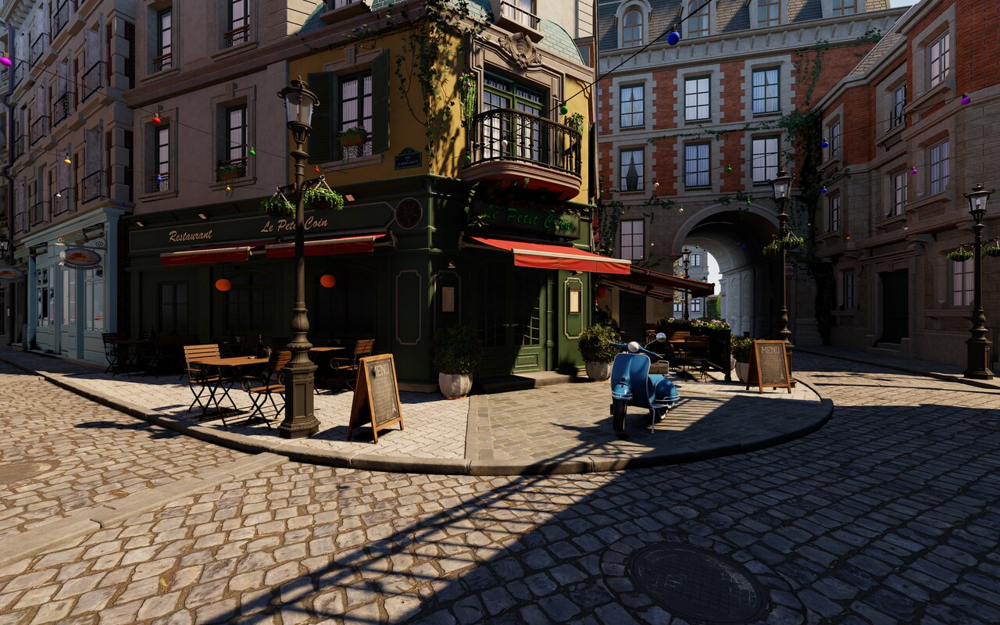 | 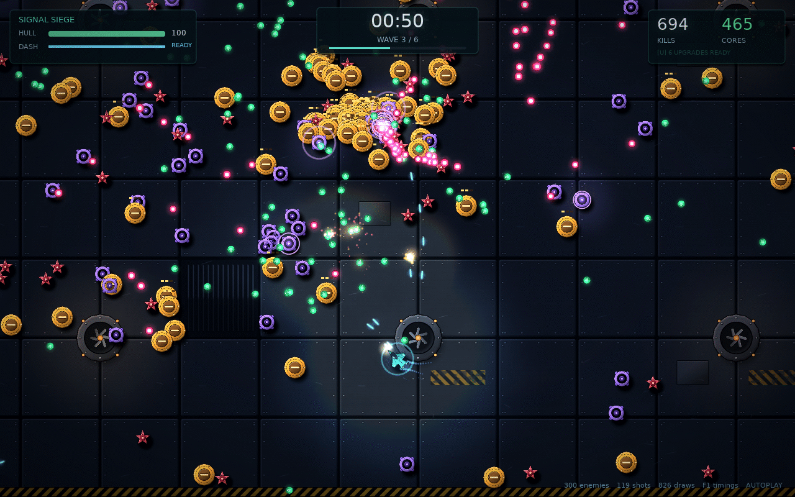 |
|:-:|:-:|
| <sub>**Bistro** in 3D — physically based materials, sun shadows and global illumination from the sky and sun</sub> | <sub>**Signal Siege** — 2D arena survival: 2D lights, particles, bloom, four languages</sub> |
| 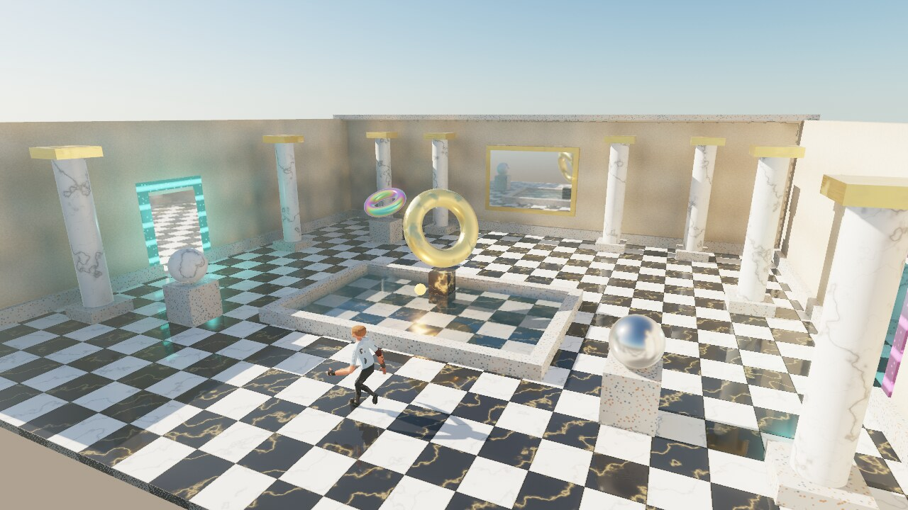 | 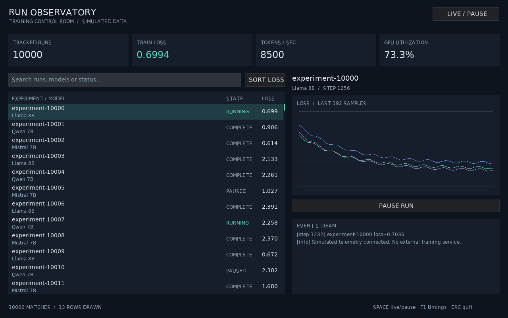 |
| <sub>**[Atrium](https://github.com/AmedeoBiolatti/kin-gallery)** — mirrors, portals, water, reflection probes and material graphs (marble, brass, terrazzo)</sub> | <sub>**Run Observatory** — a data app on ui2: virtualized tables, charts, live updates</sub> |

> **Status — v0.3.0.** Windows and Linux are supported; Android and the browser
> (WebGL2) are experimental, and so is 3D (`KIN_EXPERIMENTAL_3D`). APIs are young and may change between
> minor versions; the [changelog](docs/changelog.md) records every change.

## What you can build

### 2D games

| 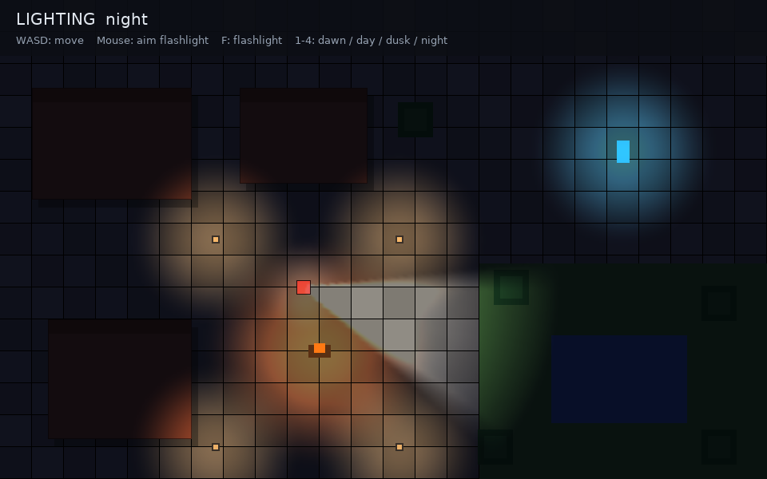 | 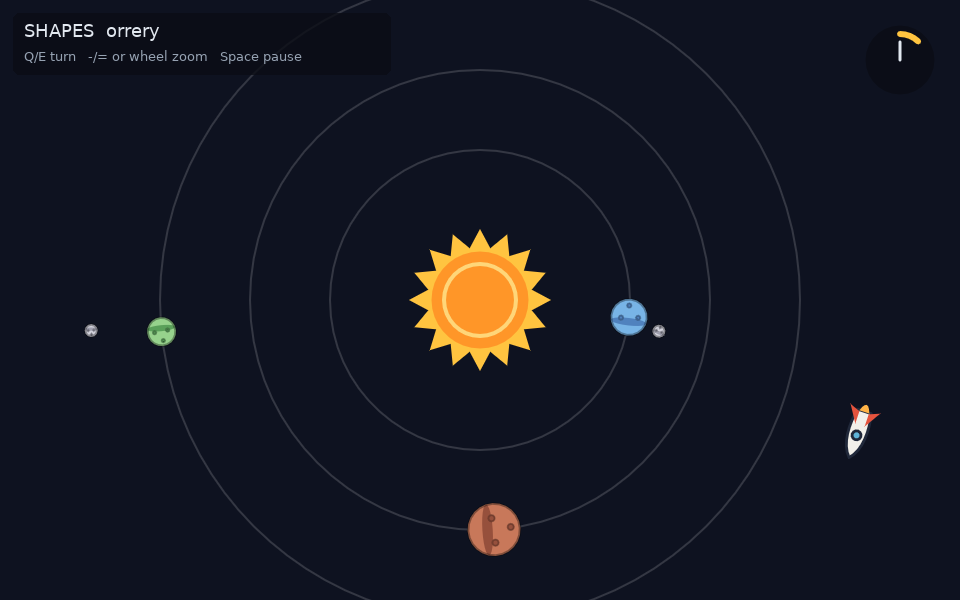 | 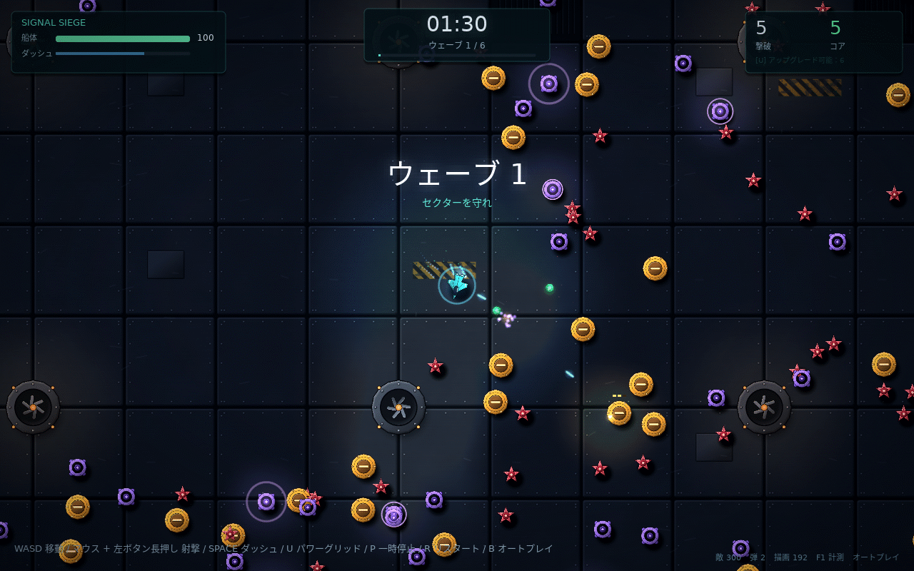 |
|:-:|:-:|:-:|
| <sub>2D lights and shadows in linear HDR, tonemapped and graded</sub> | <sub>Vector shapes and SVG under a camera that zooms and turns</sub> | <sub>Text in any script, right to left, switched while the game runs</sub> |

- **Drawing:** sprites in instanced batches, tilemaps (square, isometric, hex, autotiled terrain), parallax, particles
  that stream and change over their lives, vector shapes and SVG, clips and masks, cameras that follow, zoom, turn and
  shake, post-processing, and an opt-in linear HDR pipeline with LUT grading ([rendering](docs/rendering.md)).
- **Light:** 2D point and cone lights with soft shadows, normal-mapped sprites lit on the GPU.
- **Animation:** sprite animations, 2D skeletons with weighted meshes, layers and IK ([skeletal](docs/skeleton_2d.md)),
  state machines, tweens and timers ([animation](docs/animation_system.md)).
- **Gameplay:** Box2D physics with character controllers and one-way platforms ([2D physics](docs/physics_2d.md)),
  square/hex pathfinding and [hex grids](docs/hex_grids.md), scenes and doors as data
  ([scene flow](docs/scene_flow.md)), [saves](docs/saving.md), [dialogue](docs/dialogue.md).
- **Content:** Aseprite, Tiled and LDtk imports ([importing](docs/importing_2d.md)), hot reload of data and scripts,
  asset scopes and budgets ([assets](docs/assets.md)), and games shipped as one `.kinpak` ([shipping](docs/shipping.md)).

### 3D games (experimental)

| 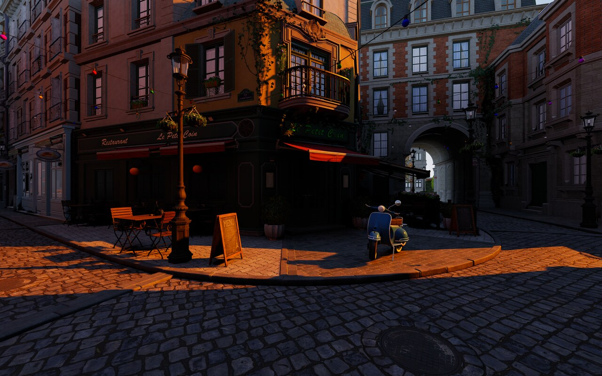 | 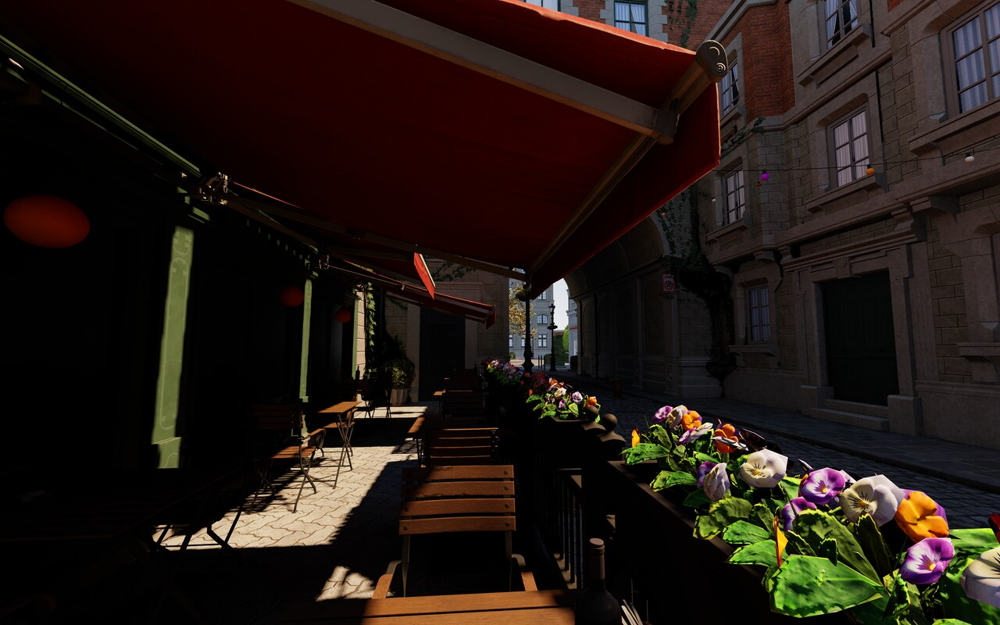 | 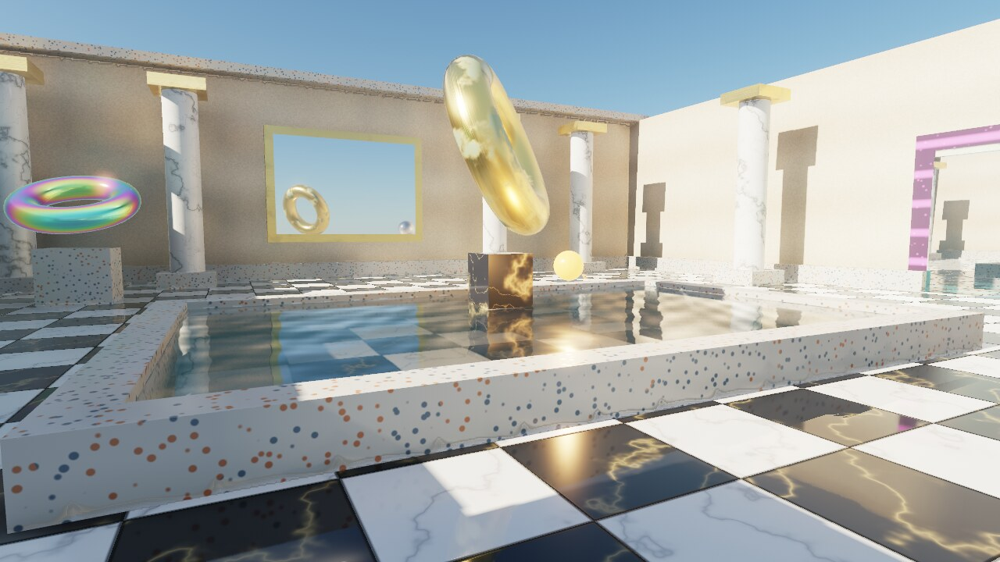 |
|:-:|:-:|:-:|
| <sub>**Bistro** at dusk: the same scene, the sun moved</sub> | <sub>**Bistro**: light bounced into the shade under the awning</sub> | <sub>**Atrium**: rippled water, a mirror, an iridescent glass ring</sub> |
| 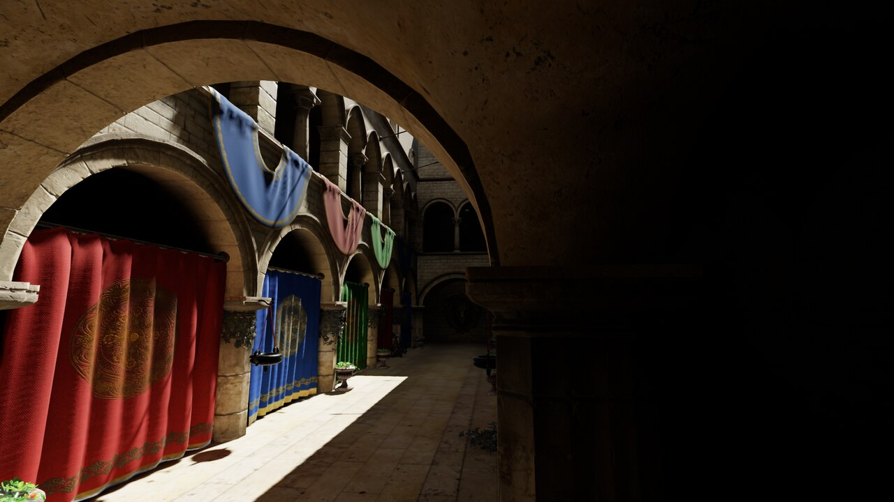 | 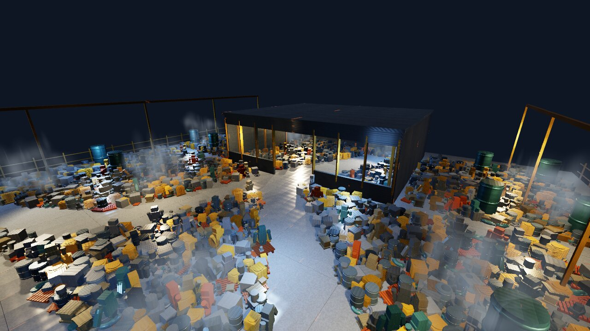 | 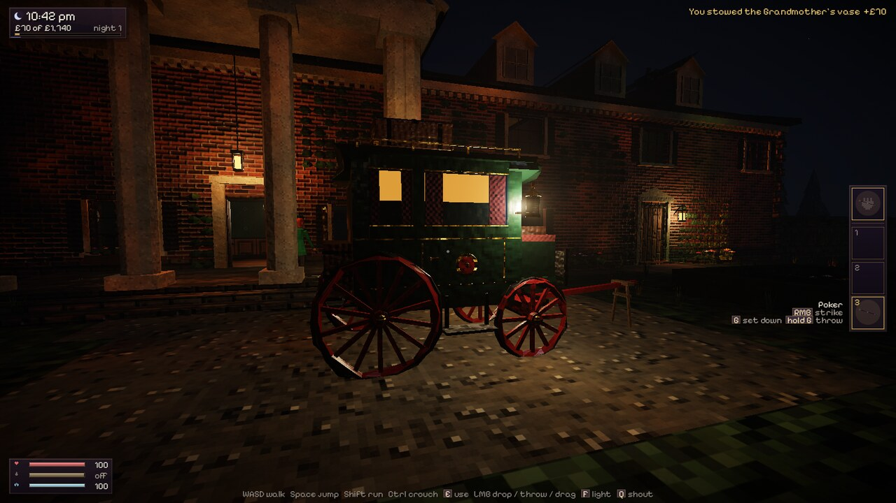 |
| <sub>**Sponza**: GI, ambient occlusion, contact shadows, TAA</sub> | <sub>**Industrial yard**: thousands of objects, spot shadows, steam</sub> | <sub>**A Lovely Night of Terror**: lanterns lighting the night fog</sub> |

<sub>Bistro: Amazon Lumberyard Bistro (CC BY 4.0), via Logan Preshaw's and John James Gutib's ports, drawn by kin
in the external benchmark port of the scene; the scene's assets are not in this repository. Sponza: Crytek, from the
Khronos glTF Sample Assets, fetched by `tools/reference/fetch.py`. A Lovely Night of Terror is a co-op horror
game made with kin; it is not in this repository. The atrium and Summit are in the [kin gallery](https://github.com/AmedeoBiolatti/kin-gallery).</sub>

- **Rendering:** physically based materials, sun, point and spot shadows (up to eight shadowed point lights), area
  lights, voxel global illumination, mirrors, portals, water, reflection probes and screen-space reflections,
  temporal anti-aliasing, volumetric fog lit by local lights and the sun,
  auto exposure, bloom, decals, skinning and morph targets, clustered level of detail and instanced batches
  ([3D rendering](docs/rendering_3d.md), [render graphs](docs/render_graph.md)).
- **Materials:** node-based material graphs compiled into the stock shaders, and an importer for Unreal, Unity and
  Godot materials and their graphs (`kin_import_material`).
- **Physics:** Jolt Physics with character controllers, ragdolls, joints and scene queries
  ([3D physics](docs/physics_3d.md)).
- **Scenes:** glTF models, prefabs and pools, `SceneSession3D` for loading, frame stages, physics and rendering in
  one place, and gameplay in C++ or Lua ([Lua 3D range](examples/README.md#lua-3d-range)).

### Apps and tools

| 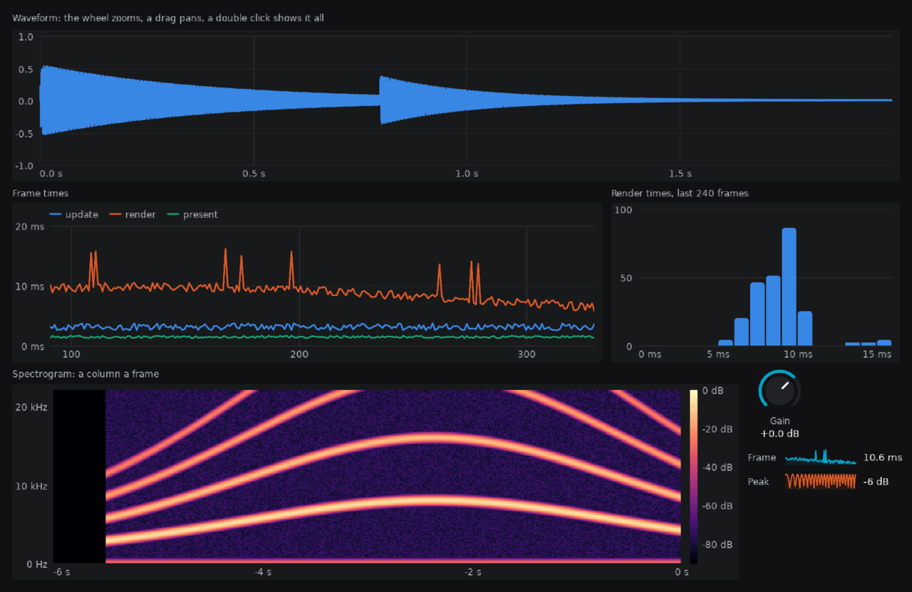 | 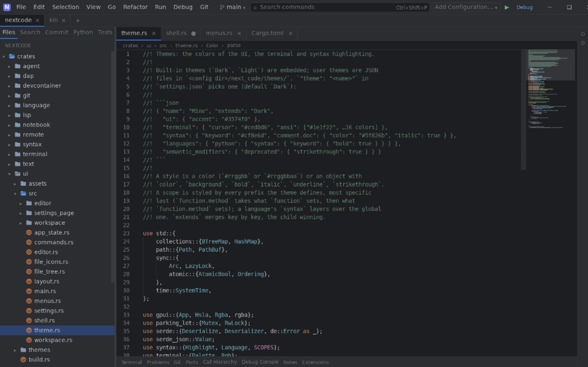 | 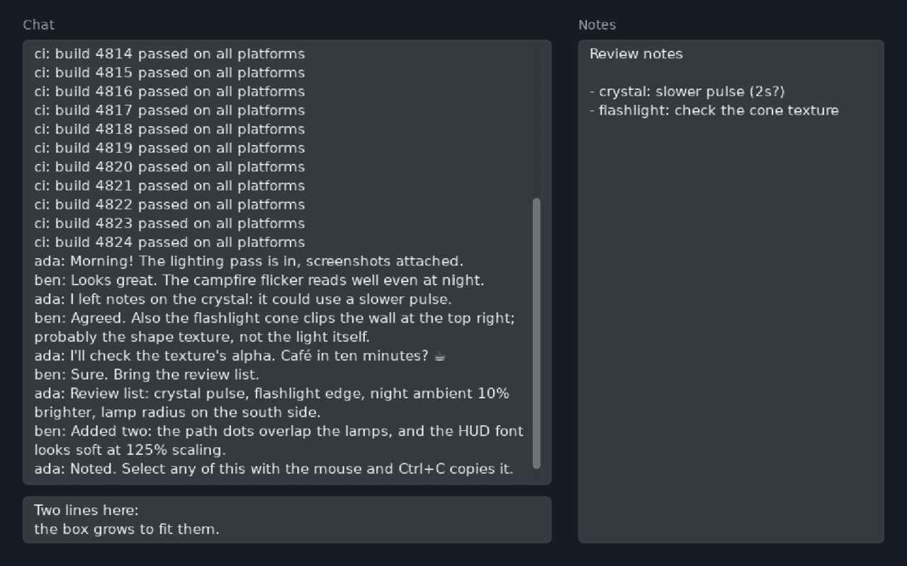 |
|:-:|:-:|:-:|
| <sub>Plots, histograms, heat maps and dials</sub> | <sub>An IDE window composed from boxes and labels</sub> | <sub>Multi-line text editing with selection and undo</sub> |

Kin's UI layer, **ui2**, draws game HUDs and whole applications with the same code. It lays out boxes, rows and
scroll areas like a web page and comes with buttons, sliders, text fields and editors, virtualized lists, tables
and trees, menus and popovers, docks, inspectors and node graphs, charts, themes from data files, controller and
touch navigation, input methods, and an optional bridge to the system's screen readers ([UI](docs/ui.md)). An app
can sleep until something changes (`wait_for_events`), so an idle tool barely uses the CPU. The same apps run on
Android phones.

```cpp
#include <kin/runtime/scene_app.hpp>
#include <kin/ui2/context.hpp>
#include <kin/ui2/widgets.hpp>

namespace ui2 = kin::ui2;

class Settings final : public kin::Scene {
public:
    void render(kin::SceneContext& ctx) override {
        ctx.renderer.clear(_ui.theme().palette.background);
        _ui.begin(ctx.input, ctx.renderer, ctx.dt);
        _ui.begin_layout({0, 0, 480, 200});
        {
            auto page = _ui.box(ui2::make_id("page"), ui2::vbox().fill().pad(16).gap(8));
            _ui.label("Music volume");
            _ui.widget(_volume, ui2::LayoutStyle{}.w(ui2::grow()));
            _ui.widget(_save);
        }
        _ui.end_layout();
        _ui.end();
        _ui.apply(ctx.app, ctx.window); // text input, pointer shape, redraw requests
        if (_save.clicked) {
            // write the settings
        }
    }

private:
    ui2::Context _ui;
    ui2::Slider _volume{.id = ui2::make_id("volume"), .value = 0.8f};
    ui2::Button _save{.id = ui2::make_id("save"), .label = "Save"};
};

int main(int argc, char** argv) {
    kin::SceneManager scenes;
    scenes.push(std::make_unique<Settings>());
    return kin::run_scene_app({.window = {.title = "Settings", .width = 480, .height = 200,
                                          .resizable = true, .wait_for_events = true},
                               .headless = kin::parse_headless_options(argc, argv)},
                              scenes);
}
```

### Everywhere

- **ECS on [flecs](https://github.com/SanderMertens/flecs)** — native and data-defined components, prefabs, events,
  a system scheduler with dependency graphs and parallel batches, and live inspection ([ECS](docs/ecs_entities.md)).
- **Scripting** in Lua (with typed API definitions, a debugger and scenario tests) and experimental sandboxed Python
  ([scripting](docs/scripting.md), [Python](docs/python_scripting.md)).
- **Audio** mixed on its own thread: streamed Ogg/MP3/FLAC, effects per bus, adaptive music ([audio](docs/audio.md)).
- **Input** from keyboards, mice, gamepads for several local players, and touch ([input](docs/input.md));
  [localization](docs/localization.md); [background jobs](docs/jobs.md); and store services such as Steam
  achievements, loaded at run time ([platform services](docs/platform_services.md)).
- **Agent interface** — every game gets deterministic headless runs with a JSON report, a line-JSON/HTTP control
  server, screenshots, replays and profiling from the same command-line flags
  ([agent interface](docs/agent_interface.md), [automation](docs/automation.md)).

```sh
./out/build/dev/bin/hex_demo --headless --frames=120 --seed=7 --report=-   # a seeded run, its report as JSON
./out/build/dev/bin/hex_demo --server                                       # drive it over line-JSON or HTTP
```

## Platforms

Windows (MSVC 2022) and Linux (GCC 13+ or Clang 18+) are supported and built in CI. Android (arm64) is
experimental ([Android builds](docs/android.md)), and so are browser builds on WebGL2 ([web](docs/web.md)).
Other platforms SDL3 supports may work but are untested.

## Building

Requirements: CMake 3.22+, a C++23 compiler, Git, and network access on the first configure — CMake fetches SDL3,
SDL3_image, SDL3_ttf, flecs, Box2D, Lua and sol2 with `FetchContent` (and, for 3D, cgltf, meshoptimizer and Jolt
Physics; `-DFETCHCONTENT_SOURCE_DIR_JOLTPHYSICS=<clone>` reuses a local clone).

On Linux, SDL3 also needs the windowing and audio development packages. On Debian/Ubuntu:

```sh
sudo apt-get install build-essential cmake ninja-build pkg-config \
    libx11-dev libxext-dev libxrandr-dev libxcursor-dev libxfixes-dev libxi-dev \
    libxss-dev libxtst-dev libxkbcommon-dev libwayland-dev wayland-protocols \
    libdecor-0-dev libegl1-mesa-dev libgl1-mesa-dev libgles2-mesa-dev \
    libdrm-dev libgbm-dev libasound2-dev libpulse-dev libpipewire-0.3-dev \
    libdbus-1-dev libudev-dev libibus-1.0-dev
```

Configure a development build once, then build the sample you want to run:

```sh
cmake --preset dev                                # 2D
cmake --build --preset dev --target lighting_demo
./out/build/dev/bin/lighting_demo

cmake --preset dev-3d                             # with the experimental 3D renderer
cmake --build --preset dev-3d --target camp_walk
./out/build/dev-3d/bin/camp_walk
```

On Windows, run these from a Visual Studio developer prompt. Executables land in `out/build/<preset>/bin/`. The
development presets enable precompiled headers, optional compiler-cache discovery and build tests, games and tools
only when requested; on Linux, `dev-clang` and `dev-3d-clang` offer the same with Clang. To run the tests without a
display, set `SDL_VIDEO_DRIVER=dummy` and `SDL_AUDIO_DRIVER=dummy`:

```sh
cmake --build --preset dev --target kin_scene_tests
ctest --preset dev -R '^kin-scene$'
```

See [testing](docs/testing.md) for full validation and [faster development builds](docs/build_times.md) for
caches, games using Kin as a subproject, and measurements. The main build options:

| Option | Default | Effect |
|---|---|---|
| `KIN_EXPERIMENTAL_3D` | `OFF` (`ON` in `dev-3d`) | The 3D renderer, Jolt physics and 3D scenes |
| `KIN_BUILD_GAMES` | top-level only | Demos in `games/` |
| `KIN_BUILD_EXAMPLES` | top-level only | Larger examples in `examples/` |
| `KIN_BUILD_BENCHMARKS` | top-level only | `kin_bench` and other benchmark runners |
| `KIN_BUILD_TESTS` | top-level only | Engine tests (with `BUILD_TESTING`) |
| `KIN_BUILD_ON_DEMAND` | `OFF` (`ON` in development presets) | Keep tools, samples and tests out of the default build; request their targets explicitly |
| `KIN_ENABLE_PYTHON` | `OFF` | Experimental Python scripting ([Python](docs/python_scripting.md)) |
| `KIN_SHIPPING` | `OFF` | A build to give to players ([shipping](docs/shipping.md)); the `ship` preset sets it, which turns off release profiling, the render probe, the determinism check and the agent server |
| `KIN_ENABLE_PROFILING` | `OFF` | Manual profiling macros ([profiling](docs/profiling.md)) |
| `KIN_ENABLE_RELEASE_PROFILING` | `ON` | Profiling macros in Release builds |
| `KIN_ENABLE_RENDER_PROBE` | `ON` | Headless render probe, `--probe-render` ([testing](docs/testing.md#render-probe)) |
| `KIN_ENABLE_DETERMINISM_CHECK` | `ON` | Determinism check, `--check-determinism` ([testing](docs/testing.md#determinism-check)) |
| `KIN_ENABLE_AGENT_SERVER` | `ON` | The agent server, `--server` ([agent interface](docs/agent_interface.md#server-mode)) |
| `KIN_ENABLE_NET` | `OFF` | Experimental networking: transports and sync models, `kin::net` ([networking](docs/networking.md)) |
| `KIN_ENABLE_VOICE` | `OFF` | Voice chat: Opus voice, noise suppression and echo gate, `kin::voice` ([voice chat](docs/voice.md)); fetches Opus and RNNoise |
| `KIN_PACK_CONTENT` | `ON` | Ship a game's content as one `.kinpak` rather than a folder |
| `KIN_REQUIRE_GPU_SHADERS` | `KIN_SHIPPING` | Stop at configure when the GPU shaders cannot be built (no glslc or `KIN_SPIRV_DIR`) |

## Demos and examples

Small demos in [`games/`](games), each one focused on a few engine features:

| Demo | Shows |
|---|---|
| [`starter`](games/starter/README.md) | The smallest runnable game: start new projects here |
| `lighting_demo` | Ambient, point and cone lights at night, in linear HDR |
| `shapes_demo` | Vector shapes and SVG turning through an entity hierarchy under a zooming camera |
| `hex_demo` | Hex coordinates, picking, movement range and A* paths in all four hex layouts |
| `isometric_demo` | Isometric tilemaps and draw ordering |
| `charts_demo`, `text_edit_demo`, `studio_demo`, `nextcode_look` | ui2 apps: charts, text editing, editor and IDE layouts |
| `ecs_systems_demo`, `ecs_graph_demo`, `ecs_parallel_bench` | The ECS system scheduler, from a pipeline to parallel batches |

Larger games and applications in [`examples/`](examples/README.md):

| Example | | |
|---|---|---|
| **Signal Siege** | 2D | Arena survival with menus, upgrades, saves, four languages and a shipping preset; also drawn in 3D with `--view 3d` |
| **Run Observatory** | App | A simulated training dashboard: 10,000-row tables, charts, an event stream |
| **2D workflow** | 2D | Imported art, rooms, input contexts, asset budgets and Lua scenario tests |
| **Python garden** | 2D | A platformer whose gameplay is all Python (`KIN_ENABLE_PYTHON`) |
| **Signal Breach** | 3D | Signal Siege in first person |
| **Camp walk**, **Projectile range**, **Lua 3D range** | 3D | Starting points for 3D games on `SceneSession3D`, in C++ and Lua |
| **Bunker exit** | 3D | Auto exposure, decals and morph targets |
| **Planar views** | 3D | Mirrors, portals and water |
| **Industrial yard** | 3D | A large Forward+ workload, shared with a Godot version for comparisons |
| **Sponza walk** | 3D | A renderer viewer with every feature switchable (Sponza downloaded separately) |

Larger games made with kin, such as **Summit** (a climbing expedition, also in the browser), **Blockfield** (a voxel
world), the mirror **Atrium** and the **Material gallery**, are in the [kin gallery](https://github.com/AmedeoBiolatti/kin-gallery). Each builds against kin
the way your game would.

## Using kin in a game

Start with the [minimal runnable game](games/starter/README.md) and the [project workflow](docs/project_workflow.md)
for layout, current examples and growth conventions. Existing projects should keep their established structure.

A game is its own project that adds kin's source tree with `add_subdirectory`. As a subproject kin builds only its
engine: its demos, examples, benchmarks and tests default to on only when kin is the top-level project.

With `FetchContent`:

```cmake
cmake_minimum_required(VERSION 3.22)
project(my_game LANGUAGES C CXX)
set(CMAKE_CXX_STANDARD 23)

include(FetchContent)
FetchContent_Declare(kin
    GIT_REPOSITORY https://github.com/AmedeoBiolatti/kin.git
    GIT_TAG v0.3.0
)
FetchContent_MakeAvailable(kin)

add_executable(my_game src/main.cpp)
target_link_libraries(my_game PRIVATE kin::engine)
kin_game(my_game TITLE "My Game")   # content/ beside the CMakeLists
```

The game finds that content with `kin::find_content_root(KIN_GAME_CONTENT, argc, argv)`. While it is made, the
content is read from the source folder; once it ships, from one `.kinpak` beside the executable. The
`my_game_package` target makes the archive players get from an optimized build; see [shipping](docs/shipping.md).

Or with a local checkout beside the game:

```cmake
set(KIN_DIR "${CMAKE_CURRENT_SOURCE_DIR}/../kin" CACHE PATH "Source tree of the kin engine")
add_subdirectory("${KIN_DIR}" kin)
```

Kin installs games, not itself, so `find_package(kin)` is not supported.

## Documentation

| Topic | |
|---|---|
| Start here | [starting and growing a project](docs/project_workflow.md), [manifest](docs/manifest.md), [changelog](docs/changelog.md) |
| Agents and automation | [agent interface](docs/agent_interface.md), [automation](docs/automation.md), [testing](docs/testing.md), [profiling](docs/profiling.md) |
| ECS | [entities](docs/ecs_entities.md), [components](docs/ecs_components.md), [data components](docs/ecs_data_components.md), [systems](docs/ecs_systems.md), [events](docs/ecs_events.md), [prefabs](docs/ecs_prefabs.md), [inspection](docs/ecs_inspection.md), [editor workflow](docs/ecs_editor_workflow.md) |
| 2D | [rendering](docs/rendering.md), [animation](docs/animation_system.md), [skeletal animation](docs/skeleton_2d.md), [2D physics](docs/physics_2d.md), [2D workflows](docs/2d_workflows.md), [importing](docs/importing_2d.md), [hex grids](docs/hex_grids.md), [scene flow](docs/scene_flow.md) |
| 3D (experimental) | [3D rendering](docs/rendering_3d.md), [3D physics](docs/physics_3d.md), [render graphs](docs/render_graph.md), [glTF profile](docs/gltf_profile3d.md), [validation](docs/rendering_validation.md) |
| UI and apps | [UI](docs/ui.md), [localization](docs/localization.md), [input](docs/input.md) |
| Engine | [audio](docs/audio.md), [assets](docs/assets.md), [hot reload](docs/hot_reload.md), [saving](docs/saving.md), [dialogue](docs/dialogue.md), [scripting](docs/scripting.md), [Lua development](docs/lua_development.md), [Python](docs/python_scripting.md), [files and processes](docs/platform.md), [background jobs](docs/jobs.md), [platform services](docs/platform_services.md), [determinism](docs/determinism.md), [networking](docs/networking.md) (experimental), [voice chat](docs/voice.md) |
| Shipping | [shipping a game](docs/shipping.md), [Android](docs/android.md), [web](docs/web.md), [build times](docs/build_times.md), [third-party notices](docs/third_party_notices.md) |

## Contributing

Issues and pull requests are welcome — see [CONTRIBUTING.md](CONTRIBUTING.md) and the
[Code of Conduct](.github/CODE_OF_CONDUCT.md). Changes are recorded in the [changelog](docs/changelog.md).

## License

Kin is released under the [MIT License](LICENSE). Its dependencies are under their own permissive licenses; see
[docs/third_party_notices.md](docs/third_party_notices.md).
