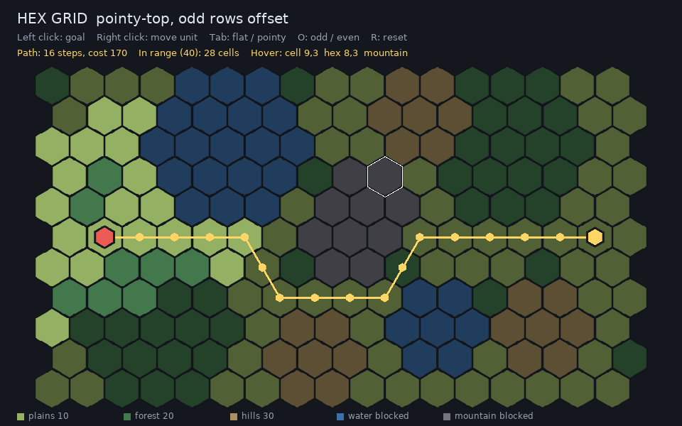

# Hex Grids

`kin/core/hex.hpp` has the coordinate math for hex maps, and
`kin/pathfinding/pathfinding.hpp` searches them. `games/hex_demo` shows both:
picking, a unit's movement range, and A* paths in all four layouts.



## Coordinates

A hex is an axial coordinate `kin::Hex{q, r}`; the third cube coordinate is
`s() == -q - r`. Axial coordinates make the math simple and exact:

```cpp
kin::Hex a{2, -1};
kin::hex_distance(a, {0, 0});        // 2
kin::hex_neighbor(a, 0);             // one step in direction 0
kin::hex_neighbors(a);               // all six
kin::hex_rotate_cw(a);               // 60 degrees about the origin
kin::hex_ring({0, 0}, 3);            // the 18 hexes 3 steps away
kin::hex_range({0, 0}, 2);           // the 19 hexes within 2 steps
kin::hex_line(a, {-3, 4});           // hexes along a straight line
```

`kin::HexDirections` lists the six directions. Each index is 60 degrees
counterclockwise on screen from the previous one, and `d + 3` is the opposite of
`d`. For pointy-top hexes, direction 0 is east; for flat-top hexes, south-east.

## Layouts: pixels and offset cells

A `kin::HexLayout` places hexes on screen and in a rectangular array:

```cpp
kin::HexLayout layout{
    .orientation = kin::HexOrientation::PointyTop, // or FlatTop
    .size = {24.0f, 24.0f},  // center-to-corner radius; unequal values squash
    .origin = {40.0f, 40.0f}, // where hex (0, 0)'s center goes
    .offset = kin::HexOffset::Odd,
};
kin::Vec2f center = layout.to_pixel(hex);
kin::Hex picked = layout.from_pixel(mouse);    // the hex under a point
std::array<kin::Vec2f, 6> corners = layout.corners(hex);
kin::Vec2f box = layout.hex_extent();          // one hex's bounding box
```

Maps are usually stored as `cols x rows` arrays of offset cells `{col, row}`.
`to_offset()` and `from_offset()` convert. With pointy-top hexes every other
row is shifted half a hex right; with flat-top hexes every other column is
shifted half a hex down. `HexOffset::Odd` shifts the odd ones, `Even` the even
ones. These are the four conventions described on
[Red Blob Games](https://www.redblobgames.com/grids/hexagons/). A rectangle of
offset cells forms a rectangle on screen.

## Pathfinding

`kin::HexGridNav` describes a `cols x rows` map of offset cells, with the same
`blocked` and `cost` callbacks as `kin::GridNav`. Costs are for entering a
cell; the default is 10.

```cpp
kin::HexGridNav nav{
    .cols = 40,
    .rows = 30,
    .layout = layout, // only the orientation and offset are used
    .blocked = [&](int col, int row) { return map.is_water(col, row); },
    .cost = [&](int col, int row) { return map.is_forest(col, row) ? 20 : 10; },
};
std::vector<kin::Vec2i> path = kin::find_path(nav, start, goal);
std::vector<kin::HexReach> range = kin::reachable_cells(nav, start, 40);
```

- `find_path` returns the cheapest path from `start` to `goal`, both included, or
  nothing when there is none. Equally cheap paths are broken the same way on
  every run and every platform.
- `reachable_cells` returns every cell the unit can reach with a budget, with its
  cheapest cost: a movement range. Sorted by cost, then row, then column.
- `nav.neighbors(cell)` lists a cell's in-bounds neighbors.

The A* heuristic assumes no step costs less than
`HexPathOptions::min_step_cost` (10). If some cells cost less, pass a lower value,
or the path may not be the cheapest.

## Navigation meshes

`kin/pathfinding/navmesh3d.hpp` finds paths over a 3D level instead of a grid.
`kin::build_navmesh3d` takes a triangle soup (positions and indices, or a
`MeshData3D` and its transform with `KIN_EXPERIMENTAL_3D`), welds its vertices,
keeps the triangles that face up and are no steeper than `max_slope_degrees`,
joins those that share an edge, and numbers the connected regions. The result,
`kin::NavMesh3D`, is plain data on the CPU; it needs only `kin/core`, so it is in
the build without 3D too.

```cpp
kin::NavMeshBuildOptions3D options{.max_slope_degrees = 40.0f, .agent_radius = 0.4f,
                                    .agent_height = 1.8f, .max_step_height = 0.25f};
auto built = kin::build_navmesh3d(level.vertices, level.indices, options);
if (!built) return report(kin::diagnostics3d_text(built.diagnostics));
kin::NavMesh3D nav = std::move(*built);

std::vector<kin::Vec3f> path = kin::find_path(nav, bot_position, goal); // the corners, both ends included
if (auto hit = kin::raycast(nav, bot_position, bot_position + heading * 2.0f)) {
    steer_away(hit->normal); // the edge of the walkable ground, 2 m ahead
}
std::optional<kin::NavPoint3D> on = kin::nearest(nav, click, {1.0f, 2.0f, 1.0f});
std::optional<kin::NavPoint3D> wander = kin::random_point(nav, key);
```

`max_step_height` joins oppositely oriented tread edges whose projected endpoints
match within `weld_distance` and whose vertical gap is within the setting. Zero
keeps the original shared-edge topology. Stair paths include both heights at each
step so a movement controller can perform the ascent/descent. This joins matching
edges; it does not bridge horizontal gaps or manufacture ramps. Height clearance
still applies. Use tessellated walk surfaces for radius erosion, which removes
whole unsafe triangles conservatively. Border clearance propagates locally along
connected walk surfaces, so an upper floor does not erode the floor below it.

- `find_path` snaps both ends onto the mesh (within `NavPathOptions3D::extents`
  on each axis) and returns the path's corners: an A* search over the triangles'
  edges finds a corridor, the funnel algorithm pulls the string through it taut,
  and the corridor is moved past any vertex the string turned at that is not on a
  border. Corners are border vertices only. Seen from above the path is the
  shortest round the obstacles on the sides it takes; going round another side
  is sometimes shorter, by about 1 % at most in the tests (0.03 % on average).
  A segment between two corners is straight, so it can pass under a crest or
  over a dip; follow the ground with `nearest` if the height matters. Empty when
  an end is off the mesh or the ends are in different regions (`region_of`).
- `raycast` walks a straight line over the surface and returns where it first
  leaves the mesh, with the border's normal, or nothing when it gets there.
- Everything is deterministic: the same input gives the same bytes and the
  same paths on every run.

Cost: on a 200 x 200 grid of 1 m squares with a pillar every 20 m (76,800
triangles, 5.4 MiB) the build takes about 90 ms and a path between two random
points about 1.1 ms (`kin_navmesh3d_tests` prints the line). Larger triangles are
cheaper: the search's work grows with the triangles near the path.

Agent dimensions affect construction. A nonzero `agent_height` discards floor
triangles whose vertical prism intersects any input geometry above the supporting
surface, including small/sloping ceilings and vertical walls. The test covers the
whole triangle footprint, not just its vertices or centroid. With a nonzero radius,
headroom also includes the maximum uphill rise across that radius in the original
connected region. A nonzero `agent_radius` then discards triangles within that
horizontal distance of a walkable boundary, including boundaries made by headroom
rejection. Different disconnected layers do not erode each other merely because
their boundaries project to the same place. Both dimensions zero keep the original
point-agent mesh; a zero individual dimension disables its corresponding check.

Clearance is conservative: triangles are removed whole, never clipped or subdivided.
Tessellate the walk surface finely enough for the margin the game needs (the clearance
regressions use 0.1 m cells); a single large floor triangle touching a border can be
removed entirely. Include walls and ceilings in the source soup, not only the intended
walkable floor. Empty geometry after clearance is a valid empty result; check `valid()`
before finding paths. All queries, including nearest/raycast/random sampling, use
this same filtered geometry. Connectivity and regions are rebuilt after filtering.
A 1e-5 world-unit tolerance separates support contact from head obstruction.

This is static navigation for an upright agent aligned with `up`, not a physics
movement solver. Steer the character controller along the surface rather than
teleporting along corner-to-corner chords through crests/dips. There are no off-mesh
links (jumps, ladders), costs per area or moving obstacles: rebuild when geometry or
agent dimensions change. See the [content profile](gltf_profile3d.md#navigation-geometry)
for the authoring contract. The cost above measures point-agent construction;
clearance adds geometry/BVH work and is an offline/loading operation.
