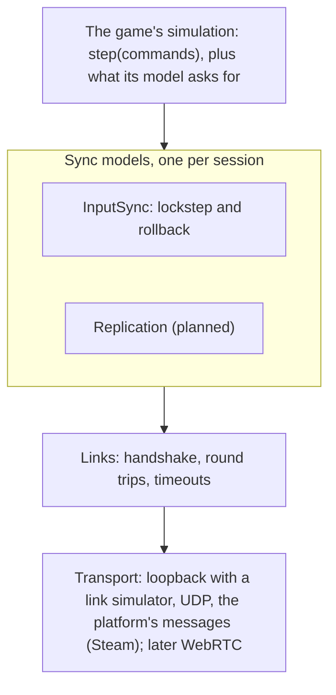

# Networking (experimental)

`kin/net` plays a game with other people over a network. It is experimental: it builds only with
`-DKIN_ENABLE_NET=ON`, nothing else in kin depends on it yet, and its APIs will change.

A game picks a **sync model**, the rule for what crosses the network and who decides what happens. Everything
under the model (transports, handshakes, round trips, a link simulator, the session interface) is shared, so a
second model is added beside the first without touching it, and a game can move between models by adding
capabilities to its simulation, not by rewriting it.

| Model | State | What crosses the network | Suits |
|---|---|---|---|
| **Input sync**: lockstep or rollback | built | each player's commands; every peer runs the whole simulation | 2 to 8 players: fighting and action games, co-op, RTS, factory and colony games, turn-based and tactics |
| **Replication** (server-authoritative) | planned | the server's state, per player as much as they may see; clients predict only themselves | many players, competitive shooters, hidden information, persistent worlds |

## Which model for which game

Input sync sends only commands, so its bandwidth does not grow with the world, replays and spectating come from the
command log, and no peer can send a forged state. In exchange:

- every peer simulates everything, and the slowest machine sets the pace;
- every peer holds the whole state: nothing is secret from a player who reads memory;
- a rollback costs about `step time x ticks rewound`, and every extra player adds wrong predictions;
- joining a game in progress means sending the whole state;
- every peer must run the same build and the same content, and the simulation must be deterministic: one difference
  ends the session (a *desync*).

| Game | Fit | Mode |
|---|---|---|
| Fighting, 1v1 action, sports, platformers, party games (2 to 4) | good | rollback |
| Co-op action, 2 to 4 players (Summit) | good | rollback, or lockstep with a few ticks of delay |
| RTS, factory, colony, automation | good: the state is far too big to replicate, commands are rare | lockstep, 100-200 ms of delay hidden by instant feedback |
| Turn-based, tactics, board games | good | lockstep |
| Battle royale, MMO, shooters with 16+ players | poor: every late command stalls or mispredicts for everyone | replication |
| Competitive games where hidden information is the game (wallhacks, card hands) | poor: every peer has everything | replication |
| Persistent or open worlds with drop-in, drop-out | poor: every join sends the world | replication |
| Heavy simulations under rollback (destruction, fluids, thousands of bodies) | poor for rollback | lockstep, if the genre bears the delay |

## Layers



| Header | What it is |
|---|---|
| `kin/net/transport.hpp` | `Transport`: unreliable datagrams of at most `max_datagram()` (1200) bytes to numbered peers |
| `kin/net/loopback.hpp` | `LoopbackNetwork`: in-process endpoints with latency, jitter, loss and duplication per link, on a clock the owner sets |
| `kin/net/udp.hpp` | `UdpTransport`: IPv4, or IPv6 with IPv4 mapped in; non-blocking; not in web builds |
| `kin/net/services_transport.hpp` | `ServicesTransport`: the platform's messages between players (Steam's, across NATs and through relays); peers are players |
| `kin/net/lobby_match.hpp` | From a lobby to a match: `start_lobby_match()`, `read_lobby_match()`, `configure_input_sync()` |
| `kin/net/link.hpp` | `Links`: the handshake every model shares, round trips, timeouts, goodbye; `compatibility_hash()` |
| `kin/net/session.hpp` | `Session`: what every model's session offers the app loop, a lobby and the debug overlay |
| `kin/net/sim.hpp` | The capabilities a simulation provides (`Simulation`, `DeterministicSim`, `RollbackSim`), `CommandCodec`, `StepInfo` |
| `kin/net/input_sync.hpp` | `InputSync<Sim, Command>`: the input sync model |
| `kin/net/sync_test.hpp` | `sync_test()`: checks that a simulation saves everything it reads |

## Input sync

Every peer runs the same simulation from the same commands, one fixed tick at a time. Only the commands cross the
network. Two knobs set how the wait for remote commands is hidden:

- **`input_delay`**: a command given now applies `input_delay` ticks later, which gives it that long to reach the
  other peers. With a delay at least the one-way latency in ticks, nothing ever has to be predicted.
- **`max_prediction`**: how many ticks a peer may run on predicted commands. `0` is **lockstep**: a tick runs once
  every player's command for it has arrived (no saving, no rollback, the simulation needs no `save()`). Above `0` is
  **rollback**: a missing command is predicted (the player keeps doing what they did), and when the real one
  arrives and differs, the state from before that tick is restored and the ticks since run again.

```cpp
#include <kin/net/input_sync.hpp>
#include <kin/net/udp.hpp>

std::string error;
auto udp = kin::net::UdpTransport::open({.port = 7777}, &error);
const kin::net::PeerId other = udp->add_peer(address, 7777, &error);

Game game(seed); // the game's own simulation
kin::net::InputSync<Game, Command> session(game, *udp, {
    .players = 2,
    .local_player = 0,
    .peers = {kin::net::no_peer, other}, // the transport peer of each player slot
    .input_delay = 2,
    .max_prediction = 8,
    .game = kin::net::compatibility_hash("my_game", "1.2"),
});

// Every rendered frame:
session.set_local_input(read_command(input));
session.update(now_us); // runs the ticks that are due, and again after a rollback
draw(game, session.alpha());
if (kin::net::session_over(session.status())) {
    show(session.status_detail());
}
```

Peers start together once every handshake is done; the first `input_delay` ticks have the default command for
every player. The peers' clocks are kept within about a tick: each reports how far ahead it thinks it is, and the one
ahead runs a tenth slower until the other catches up (half the difference of the two views is used, as GGPO does,
so an error both sides make the same way cancels). A peer that must wait for commands stops its clock instead of
banking the time, so it never runs a burst of ticks afterwards.

### What the simulation provides

```cpp
struct Command {        // plain data, one per player per tick
    i8 move_x = 0, move_y = 0;
    u8 buttons = 0;     // levels (held or not), not edges
};

class Game {
public:
    void step(std::span<const Command> commands);                          // or step(commands, const StepInfo&)
    u64 state_hash() const;                                                 // DeterministicSim: lockstep
    std::vector<u8> save() const;                                           // RollbackSim: rollback
    bool restore(std::span<const u8> bytes);
};
```

`InputSync` checks these at compile time (`static_assert(kin::net::RollbackSim<Game, Command>)` says the same up
front). A lockstep-only simulation (no `save`/`restore`) with `max_prediction > 0` fails to start and says so.

- **Commands are levels.** A held button is the same command tick after tick, which is what makes prediction right
  most of the time. A step that wants "pressed" compares with the previous tick's command, which it keeps in its
  state.
- **`StepInfo`** says which tick runs, whether it runs again after a rollback (`resimulating`: its sounds and effects
  already played) and whether every command in it is real (`confirmed`).
- **`save_into(std::vector<u8>&) const`**, if the simulation has it, is used instead of `save()`, so a snapshot every
  tick reuses its buffer.
- **`set_on_confirmed()`** gets every tick's real commands once, in order: a replay log.

### Commands on the wire

A command crosses the network as `CommandCodec<Command>::size` bytes. Plain data with no padding and no floats
(`std::has_unique_object_representations_v`) is copied as it is. Anything else specializes `CommandCodec`, which is
also the place to quantize analog values, so that small differences do not count as wrong predictions:

```cpp
template <> struct kin::net::CommandCodec<Steer> {
    static constexpr std::size_t size = 3;
    static void write(const Steer& steer, std::span<u8, size> out); // turn in thousandths, boost as a byte
    static Steer read(std::span<const u8, size> in);
};
```

A struct with padding has no codec and does not compile: its padding bytes would differ between peers.

### Desyncs

Every `hash_interval` ticks, each peer sends the hash of its state after a tick whose commands were all real, and
compares the hashes it gets. A difference stops the session (`SessionStatus::desynced`); `desync()` names the tick
and the player. The [determinism check](testing.md#determinism-check) and `sync_test()` find the cause on one
machine.

### Settings

| Field | Default | |
|---|---|---|
| `players` | 2 | 1 to 16 player slots; with 1 the session runs alone (no transport traffic) |
| `local_player` | 0 | this peer's slot |
| `peers` | | the transport peer of each slot (the local slot's entry is ignored) |
| `tick_rate` | 60 | ticks a second |
| `input_delay` | 2 | ticks; at most 30. Must match on every peer |
| `max_prediction` | 8 | ticks; at most 60; 0 is lockstep |
| `hash_interval` | 30 | ticks between state comparisons; 0 never. Must match |
| `max_catchup` | 8 | the most ticks one `update()` runs after a hitch |
| `game` | 0 | the compatibility hash; peers of another game, version, build or content refuse each other |
| `session` | 0 | the match, as a lobby numbers it |
| `links` | | handshake, ping and timeout intervals |

`stats()` reports the current and confirmed ticks, rollbacks (count, ticks run again, deepest), waits, slowed
updates, hashes compared and the clock advantage.

## Transports

**`LoopbackNetwork`** runs any number of endpoints in one process. Each direction of each link has its own latency,
jitter, loss and duplication, or can be cut; the same seed always loses and delays the same datagrams. Its clock is
whatever time the owner sets, so a test plays a minute of a laggy four-player match in milliseconds.

**`UdpTransport`** binds a non-blocking socket (`port = 0` picks a free one). `add_peer()` resolves an address.
Datagrams from other addresses are ignored, unless `accept_unknown` is on: then one that starts like kin's messages
gets a new peer id (up to `max_peers`, never reused), which is how a host learns its players. It does not cross NATs:
use `ServicesTransport` for that.

**`ServicesTransport`** sends through the platform's messages between players
([platform services](platform_services.md#lobbies-and-messages)). On Steam those messages go peer to peer where
they can and through Valve's relays where they can't, so two players behind any NAT reach each other, and neither
sees the other's address. Peers are players: `add_peer("steam:7656...")`. A message from a player it does not know
gets a new peer id (unless `accept_unknown` is off). The platform takes messages only from members of the player's lobby and from
players the game sent to first. `channel` (1 unless set) keeps a match apart from the game's other messages, which
`send_message` puts on channel 0 unless told otherwise. `remove_peer(player)` forgets a player gone for good (on
`LobbyMemberLeft`): it frees their place among `max_peers`, and their peer id is never given to anyone else. The
transport needs
the services' `update()` each frame (`run_scene_app` calls it). Offline, nothing is sent. Tests use `FakeServices`
on a `kin::FakeNetwork`, which can drop messages (`drop_every`).

A transport delivers datagrams or loses them; the layers above repeat what matters. Input sync sends every command a
peer has not acknowledged in each datagram, so a lost datagram costs nothing.

## From a lobby to a match

Players meet in a lobby (`create_lobby`, `find_lobbies`, `join_lobby`, invitations). When everyone is ready, the
owner starts the match, and every member reads it from the lobby's data (`kin.match`). Slots go in the order the
owner gives (the order members joined, by default). The session number keeps this match apart from the lobby's
earlier ones. The lobby closes to newcomers until `end_lobby_match()`. A `kin.match` that lists a player twice, or
none, is not a match: `read_lobby_match` returns nothing.

```cpp
#include <kin/net/lobby_match.hpp>

kin::net::ServicesTransport transport(*services);

// The owner, when everyone is ready:
kin::net::start_lobby_match(*services);

// Every member (the owner too), on a LobbyDataChanged event:
if (const auto match = kin::net::read_lobby_match(*services)) {
    kin::net::InputSyncConfig config{.input_delay = 2, .max_prediction = 8,
                                     .game = kin::net::compatibility_hash("my_game", "1.2")};
    kin::net::configure_input_sync(*match, transport, config); // players, local_player, peers, session
    game = std::make_unique<Game>(match->session);             // the session doubles as a shared seed
    kin::set_lua_hash_seed(kin::make_key(match->session));     // before the game's scripts start
    session = std::make_unique<kin::net::InputSync<Game, Command>>(*game, transport, config);
}
```

The Lua hash seed keeps `pairs` in one order on every peer. Lobby data can be read by anyone who can find the lobby,
so in a public lobby the session is not a secret: the seed then orders tables, but does not keep outsiders from
crafting colliding strings.

`kin-net-services` plays three players this way, on a network that loses one message in seven. They find the
lobby, join it, start the match and play it under rollback, and every state hash agrees.

## Joining a game in progress

A session with `joinable` keeps slots free: their `peers` entry is `no_peer`, and an empty slot plays the default
command. A player joins one while the game runs:

1. Every player in the game calls `allow_join(slot, peer)`. The joiner starts its session with `joining`, and its
   `peers` name the players in the game. It picks a random id, which every join message carries.
2. The game's **host** (the lowest slot in it) sends the joiner the state from before the first tick that is not yet
   final everywhere, after taking back any wrong predictions, so the state is from real commands only. The others
   keep playing, and nobody waits.
3. The joiner restores the state and plays the ticks since from every player's commands, up to 120 ticks an update,
   as a spectator (`stats().spectating`). Once it has caught up, reaches every player, and (with `hash_interval`)
   one of its state hashes matched the game's, it says it is ready.
4. The host picks the first tick none of its commands has been sent for, and sends the join with its command for that
   tick. Every peer can finish that tick only with that command, so every peer applies the join at the same tick.
   A peer that ran it on a prediction runs it again. Who may decide a join at a tick is fixed by the game itself (the
   lowest slot in it the tick before), so every peer agrees on it even while the host changes.

From that tick the joiner plays. `StepInfo::present` says which slots are in the game, and `StepInfo::joined` which
arrive at this tick, so the game spawns them there. It is part of the deterministic state like any command.

```cpp
void step(std::span<const Command> commands, const kin::net::StepInfo& info) {
    for (u32 slot = 0; slot < players; ++slot) {
        if (info.joined & (1u << slot)) spawn(slot);
        if (info.present & (1u << slot)) move(slot, commands[slot]);
    }
}
```

Joining needs `save()` and `restore()`, in lockstep too. The state travels in pieces of about 1.2 KB, sixteen at a time.
The joiner keeps pieces that arrive after a lost one, and the host sends a lost piece again. In the tests, 60 KB
over a link that loses one datagram in ten arrives in under a second; a joiner takes at most 256 MB. Several players
can join at once. A joiner fails alone, and the game goes on, if:

- its state differs from the game's (a hash compared before it plays): `desynced`;
- the state stops arriving for a link timeout, or takes longer than the 256 ticks of commands each peer keeps (about
  four seconds at 60 ticks a second): "the game moved on";
- a player in the game does not answer it, or it was not told about one: the reason names the player.

A joiner that never comes, or leaves before it plays, leaves the slot empty, and nobody waits for it. A slot can then
go to someone else. Once it plays, a joiner is a player like the others: losing it ends the session.

**Through a lobby.** `start_lobby_match(services, {}, 0, free_slots)` keeps `free_slots` open. The lobby stays
joinable while one is free. The owner seats newcomers with `seat_lobby_joiners()` (on `LobbyMemberJoined`), and frees
the seat of one who leaves before playing with `free_lobby_slot()`. Every member, on `LobbyDataChanged`, reads the
match:

- a seated latecomer's `configure_input_sync` sets `joining`;
- the players in the game call `allow_lobby_joiners(match, transport, session)`.

`kin-net-services` plays it: two players start a four-slot match, Cyd joins, Dan is seated and leaves before playing,
Eve takes the slot, the lobby closes when full, and every peer's states agree tick by tick from each one's first.

## Testing a networked game

- **`sync_test()`** plays a simulation alone and, after every tick, takes it back a few ticks and plays them again.
  Every tick run again must give the same hash: state that `save()` leaves out (a counter, a cache, an RNG kept
  elsewhere) shows up as the first tick that differs. Run it before anything else.
- **A loopback match** (`tests/net_tests.cpp` has a harness) plays several sessions in one process under any
  conditions, and checks every peer against one offline run of the confirmed commands, tick by tick.
- **Two processes over UDP** on one machine check the real sockets.

## Determinism

Input sync needs a simulation that gives the same bits on every peer. [Determinism](determinism.md) lists what kin
guarantees and what is left to the game: fused multiply-adds, `kin::dmath`, RNG keys per step, the ECS scheduler's
state, Lua's hash seed (a session sets it from its key with `kin::set_lua_hash_seed()`), and which physics can roll
back (Jolt can; flecs and 2D physics cannot yet, so they suit lockstep).

## Wire format

Every datagram starts with a 12-byte header: `'k' 'n'`, the protocol version (1), a message type and the receiver's
token `u64`; numbers are little-endian. Each side picks a random token per link and sends it in its hello. A message
that does not carry the token this side picked is ignored (a hello or a protocol reject may carry 0 before the
handshake ends), so a late datagram from an earlier match between the same addresses, or a forged one, cannot end or
drive the link.

| Type | Message | Payload |
|---|---|---|
| 1 | hello | model `u32`, game `u64`, config `u64`, session `u64`, sender's slot `u32`, sender's token `u64` |
| 2 | reject | reason `u8` (the header and this layout never change) |
| 3, 4 | ping, pong | the pinger's clock `u64` |
| 5 | bye | |
| 32 | inputs | slot `u8`, sender's tick `u32`, its advantage `i16` (1/256 tick), next tick it lacks from the receiver `u32`, first tick `u32`, count `u8`, the commands |
| 33 | hash | slot `u8`, tick `u32`, state hash `u64` |
| 34 | join request | the joiner's slot `u8`, its id `u64` |
| 35 | join state | the joiner's slot `u8`, base tick `u32`, slots in the game before it `u32`, total bytes `u32`, offset `u32`, bytes |
| 36 | join ack | the joiner's slot `u8`, bytes received from the start `u32` |
| 37 | join ready | the joiner's slot `u8`, its id `u64` |

In a joinable session, inputs end with the joins their sender decided at the ticks of their commands: count `u8`,
then tick `u32`, slot `u8` and the joiner's id `u64` each.

A peer sends hellos until it hears one that carries its token (the other side heard it). Any later message from the
peer completes the handshake too, so one lost hello costs nothing. A hello whose model, game, configuration, session or
slot differs is answered with a reject naming the first difference, and so is every hello after it, so a lost reject
costs one more hello. A differing hello without our token may be a late one from an earlier match: it ends the
handshake only if no matching hello follows before the connect timeout.

## Not yet

- A lost player ends the session: nobody leaves a game that goes on. A joiner watches before it plays, but there is
  no spectator that only watches.
- Over UDP: no NAT traversal, encryption or authentication (a peer's address and token are its identity, so anyone
  who sees the traffic can forge it). Over Steam, `ServicesTransport` has all three: Steam's relays, its encrypted
  sessions and its accounts.
- Commands are copied in the machine's byte order: little-endian peers only (every desktop and console today).
- No engine integration yet: a game calls `update()` itself and draws its own simulation.

## Plan

1. Shared layers and input sync over loopback and UDP, with the sync test (done).
2. Determinism hardening: an RNG key per tick in `SceneContext`, a fixed Lua seed, the scheduler's accumulators
   saved, deterministic trigonometry (done).
3. Summit co-op over input sync, with rollback cost measured (`step` and `save` with four climbers).
4. A small replication model on loopback, kept as a test, so that the shared layers fit a second model.
5. A Steam transport (NAT traversal and relays) and lobbies (done: `ServicesTransport`, `lobby_match.hpp`, on
   any platform's lobbies and messages); late join from a saved state (done: `joinable`, `allow_join`, free slots in
   lobby matches).
6. The replication model for real: delta compression, interest management, lag compensation, a dedicated server.
