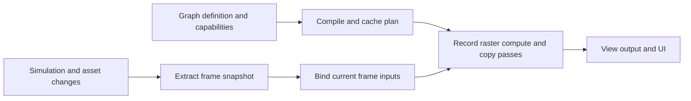

# Rendering pipeline and 3D quality plan

Status: implementation underway, 28 October 2026. Sections below describe the intended delivery; completed work and validation are recorded in [rendering progress](rendering_progress.md).

Kin should provide a fast default renderer whose materials, passes and output can be customized without forking the backend. The next work should establish correct visibility and composition, reduce repeated CPU work, account for GPU resources, and make imported art predictable. A compiled render graph should then support both the stock pipeline and developer pipelines, including ASCII rendering, alternative shadows and experiments with finite light propagation.

The intended result is a coherent default configuration with explicit overrides. Expensive features remain choices with visible costs. A game can keep using `SceneSession3D`, submit a direct `Scene3D`, extend the stock pipeline, or construct a separate pipeline using the same assets and resource services.

## Scope and current baseline

The baseline for this plan is main at `6245258`. The existing [3D plan](3d_plan.md) remains the historical design and measurement log; [3D rendering](rendering_3d.md) documents current APIs. Features described below as deliverables are proposals, not available APIs.

The concurrent `exp/realtime-lighting` work was inspected at `77b76c8`, with additional edits in progress. Recheck that branch before implementing overlapping changes. Its committed work already includes clustered local lights, anisotropic filtering, texture mip bias, specular anti-aliasing, TAA improvements, SDF and probe GI, fog sunlight through shadows, pre-pass depth reuse, asynchronous image readback and a dedicated GI sun map. Finer occupancy within GI voxels is in progress. Quality work here must incorporate those results rather than implement them again. Benchmark identities must include the commit, local patch, shaders and content used.

| Requirement | Delivery in this plan |
| --- | --- |
| Flexible and efficient rendering | Resource declarations, graph compilation, reusable geometry and lighting operations, stock pipeline migration, custom pipeline examples. |
| Remove repeated CPU scans | Mutation and structural revisions, dependency barriers, incremental transforms and extraction, a conservative path for untracked writes. |
| Better GPU memory | Allocation ledger, lifetime tests, descriptor-based accounting, transient reuse, measured cache policies and explicit budgets. |
| Better imported content | Correct material semantics, tangents, independent texture bindings, cooked assets, staged loading, atomic reload and an extended export profile. |
| Better defaults | Versioned quality and style settings, capability resolution, scene-based calibration and temporal quality tests. |
| Better materials | A canonical surface model and a versioned shader interface shared across colour, depth, shadows, picking and motion. |
| Correctness fixes | F1 culling bounds, F2 transparent order, F3 emission, F4 flat-mesh LOD, F5 cluster overflow and F6 texture samplers. |

The generic graph belongs to rendering and must remain usable in 2D-only builds. Geometry and material nodes that require experimental 3D remain optional. Existing SDL_Renderer operation and CPU-only scene testing must continue to work. WebGL2 supports an explicitly smaller set of operations; unsupported required passes must be diagnosed before execution.

Hardware ray tracing, a visual graph editor, arbitrary multi-queue scheduling and a wholesale physics replacement are later choices. The interfaces should allow alternative tracers and simulations, while the first implementation uses the current backend seam and command submission model.

## Design decisions

1. Compile a resource-aware graph into an execution plan. Start with validation, dependency resolution and resource lifetime planning; add optimizations incrementally against an unoptimized reference mode.
2. Keep graph compilation separate from shader compilation, graphics pipeline creation, draw preparation and temporal content caches. Each has different invalidation rules.
3. Make the default pipeline a maintained graph recipe. Custom pipelines and stock rendering must use the same operations and resource ownership rules.
4. Keep scene extraction independent of rendering strategy. A pipeline consumes a frame snapshot and optional motion/history data; it does not own gameplay simulation.
5. Track supported writes explicitly. Preserve correctness for existing raw mutable access through a conservative path rather than assume every write emits an ECS notification.
6. Measure total resource behaviour before choosing new memory defaults. Distinguish logical bytes, pooled allocations, in-flight storage and externally observed GPU usage.
7. Preserve complete object coverage under capacity pressure. A detail budget may select a coarser representation; it must not silently remove triangles.
8. Preserve authored appearance through import, cooking, reload and material customization. Unsupported content must produce actionable diagnostics.

## Delivery sequence

Milestones are ordered by dependencies, not calendar estimates. Keep changes reviewable and record measurements with each completed milestone.

| Milestone | Main deliverables | Depends on | Completion gate |
| --- | --- | --- | --- |
| E0 Baselines | Reproduction scenes, scan counters, resource inventory, capture protocol, ground-truth image set with its noise floor, and current lighting snapshot. | Existing tools. | Correctness, image-quality and performance baselines are reproducible. |
| E1 Rendering fixes | F1 through F6, with minimal shared material changes needed for emission and samplers. | E0. | Each regression fails before its fix and passes afterward. |
| E2 Incremental CPU work | Tracked mutation contract, validation revisions, dirty transforms and retained extraction. | E0; F1 for bounds. | Static and sparse-edit workloads meet the scan-count gates. |
| E3 Graph foundation | Logical resources, validation, compilation, caching, raster/compute operations and ASCII example. | E0 memory inventory. | Optimized and reference execution agree; stable frames reuse the plan. |
| E4 Materials and imports | Surface interface, tangents and UV bindings, shader variants, cooking, staged upload and reload. | E1; E3 for resource declarations. | Direct and cooked content agree across relevant passes. |
| E5 Stock pipeline composition | Migrate stock passes, custom shadow/geometry example and bounded slow-light example. | E2, E3, E4a; stable lighting integration. | Stock rendering preserves behaviour and examples use public APIs. |
| E6 Memory policy | Transient reuse, cache experiments, budgets and pressure behaviour. | Ledger in E0; E3; migration in E5 for final results. | Memory tests pass with complete rendering and bounded retention. |
| E7 Quality defaults | Calibrated, versioned presets and effective-settings diagnostics. | E1, E4a; stable lighting branch; E6 measurements. | Selected defaults pass visual, temporal, performance and memory gates. |
| E8 Release readiness | Backend matrix, migration guide, packaging, examples and regression reports. | E1 through E7. | Required capability tests run and supported workflows are documented. |

Deliver E4 as E4a material/shader semantics, E4b cooking/loading/reload and E4c the extended model profile. E5 and quality calibration need E4a, while importer tooling and palette extensions can proceed independently. Begin quality captures in E0, calibrate stable combinations as soon as the relevant fixes land, and repeat the final comparison after pipeline and memory changes.

Instrumentation, importer fixtures and quality captures can progress independently where their inputs are stable. Avoid introducing graph, material, resource and quality migrations in one change. Rebase or integrate lighting changes before measuring overlapping renderer paths.

## E0 Baselines and measurements

### Representative workloads

Reuse the existing reference tool, asset preview and gameplay examples. Add small synthetic scenes only where an existing workload cannot isolate the requirement.

| Workload | What it isolates |
| --- | --- |
| Static hierarchy with 10,000 and 100,000 entities | Repeated scans, transforms, extraction and retained uploads. |
| The same hierarchy with 1 percent edits and with one edited ancestor | Sparse updates and descendant propagation. |
| Grove and Industrial Yard | Masked foliage, transparent effects, local shadows, mixed object counts and moving instances. |
| Summit and Lovely Night | Gameplay phase ordering, hierarchy edits, sharp stylized materials, fixed-step presentation and scene transitions. |
| Sponza and the existing Bistro comparison | Imported PBR, dense indoor/outdoor lighting, GI, temporal detail and overdraw. |
| Material reference objects and a furnace | Texture interpretation, tangents, emission, BRDF energy and exposure. |
| Six focused regression scenes | The F1 through F6 failures below. |
| One, two and eight views | Per-view history, shared assets, resource ownership and memory growth. |

Use available content with recorded identities. CI must have small redistributable fixtures; large external scenes supplement those fixtures.

### Required counters

CPU counters should include entities visited by domain and phase, local transforms compared, world transforms recomputed, unchanged results reused, particle validations, animation poses built, extracted records changed, structural rebuilds and fallback scans. Separate useful updates from visits whose only result is finding no change.

Graph counters should include compilation count and time, cache hits, invalidation reasons, passes retained/culled/merged, execution recording time, planned resource slots and requested versus executed features. CPU recording time must not be labelled GPU pass time.

Memory counters are specified in E6. Keep counters cheap and bounded; optional detailed traces may add overhead but their cost must be labelled. Ordinary rendering must not wait for GPU counter readback.

### Comparison protocol

- Record source and shader identities, compiler flags, content hashes, backend, device, driver, resolution, samples, feature settings, frames in flight and worker configuration.
- Separate startup, graph/shader/pipeline compilation, warm-up, steady frames, edits, reloads and scene transitions. Include first-use hitches as their own result.
- Use alternating before/after runs, identical routes and at least five independent runs for consequential performance decisions. Start with 300 warm-up and 1,500 measured frames; extend runs when variance prevents a conclusion.
- Report CPU frame and relevant stage p50/p95/p99, GPU frame timing, upload bytes, peak memory and allocation events. Use external pass markers when measuring individual GPU work; fence scopes that split submissions are a separate instrument.
- Keep GPU readbacks asynchronous except explicit inspection operations. Exclude capture overhead from throughput runs and test the capture path separately.
- Compare native Release builds on real hardware; use software Vulkan for functional coverage. Record thermal throttling and background load instead of claiming a controlled comparison under uncontrolled conditions.

Initial performance gates are review thresholds, not promised speedups: investigate a repeatable regression above 5 percent in a relevant CPU/GPU metric, a new steady-frame allocation, or an unexpected full upload. Treat differences below measurement noise as inconclusive. Correctness and deliberate quality improvements may justify a cost, but it must be attached to that feature and configuration.

### Image quality against ground truth

Image quality is measured against a path-traced ground truth, beside the truth's own noise floor, with the same scene, cameras, light and display transform in every renderer. Matched pictures from the original Godot game are a second comparison and are scored against the same truth; they are not the reference. Two tool sets exist. Kin's `tools/reference` renders engine scenes against Cycles (G0 in the [3D plan](3d_plan.md)). The Bistro port's `tools/eval` (gallery repository, `bistro/tools/eval`, bistro `e7279fc` to `293e3ae`) holds a complete imported game against Cycles and Godot, with perceptual and temporal metrics. E0 should bring the second method's floor, display model, metrics and camera ways into `tools/reference`, keeping Bistro as the imported-game case.

#### Data

| Item | Content |
| --- | --- |
| Scene | Jamsers/Bistro-Demo-Tweaked at `6844fe7` (Godot 4.4), the Amazon Lumberyard Bistro exterior, as the port's baked content: 152 glTF models (116 MB) and 207 DDS textures (BC1/BC3 sRGB base colours, BC5 normal maps, mostly 2048 square; 738 MB, about 3 GB decoded). The level's data (`content/level/level.json`: statics, bodies at rest, materials, times of day) is extracted from the original by the port's `tools/extract_level.py`. |
| Light | The original's times of day in physical units. Afternoon: a 75,000 lux sun at 4,250 K with a 22,500 nit sky. Noon: 100,000 lux, 5,500 K, 30,000 nits. Dusk: 20,000 lux, 2,000 K, 6,000 nits. Night: a 3 lux moon; its lamps are not yet mapped to Cycles. |
| Views | `tools/eval/views.json`: `start` (the game's first view), `street` and `terrace` by afternoon; `start_noon` and `start_dusk`; one way, `start_walk`. Each view is an eye in the level's coordinates, a yaw and pitch, and a vertical field of view of 75 degrees. |
| Picture | 3,408 by 2,130, the timing laptop's native panel, at Normal quality. |
| Held equal | Fixed exposure at the time of day's ISO (afternoon 450; with Godot's exposure normalization, 1 nit is ISO / 3,072,007). No fog, bloom, glow, particles or player mannequin in any renderer. |
| Engine scenes | `tests/reference/scenes` (Cornell box, furnace, spheres, Sponza and others; the lighting branch adds `canyon`) isolate single effects against Cycles. |

#### Cycles ground truth

`cycles_truth.py` builds the scene in Blender 5.2.2 from the same content and level data and renders it with Cycles (OptiX on an RTX 4080 Laptop GPU).

- Units are Blender watts at 683 lm/W. The sun is lux / 683 W/m² in Godot's temperature colour and has the real sun's 0.53 degree size. The sky is Godot's ProceduralSkyMaterial with its default colours, as a panorama at nits / 683. Emission is nits / 683; the night-only emissives are dark by day.
- What glTF does not carry is rebuilt as Cycles shaders. Godot's additive blend (window panes, lamp glass) becomes a transparent BSDF added to the surface. Godot's backlight (foliage, awnings) becomes a translucent lobe of base colour times backlight colour.
- No denoiser, sample clamping or adaptive sampling. Up to 16 bounces: 8 diffuse, 8 glossy, 12 transmission, 64 transparent.
- 1,024 samples a still, with mean noise near one level of 255; 512 samples a frame of a way. Diagnostic truths render at 852 by 532 in about 20 seconds.
- Each picture is rendered with two seeds. The second seed against the first is the floor: no renderer can be shown nearer the truth than that. At the start view the floor is FLIP 0.021, JOD 9.90 and PSNR 40.0 dB.
- The truth is reviewed before its scores are trusted. `--probe` reports the object and material at a pixel. Three material errors were found this way and fixed: night-only emissives lit by day, opaque additive glass and missing backlight.
- Cost: 0.27 to 0.55 seconds a sample at full size (4.5 to 9 minutes a still). Peak host memory is about 6 GB, of which Cycles' decoded textures are 3 GB, so render one at a time. Textures are imported unpacked; packed images would add about 0.7 GB.

#### Godot comparison

The original game (its Godot 4.4 build) is driven by `tools/godot/baseline.gd`:

- `eye=`: a camera of its own at the view, with the mannequin hidden;
- `fixed_iso=`: the auto exposure off;
- `nofog=1` (with its FogVolume) and `noglow=1`;
- `mode=path path=` for ways.

It must run fullscreen at the panel's size, because a window is shrunk by the desktop's bars. The same script's `mode=bench` gives frame times for the speed comparison under the protocol above. Godot's errors are measured, not inherited: by day it is brighter than the truth (bias +8.7 levels at the start view).

#### Display transform

All three pictures are compared as the original's output would show them, in 8-bit sRGB:

- **Truth:** linear radiance × 683 × ISO / 3,072,007, then Godot's ACES (Hill's fit, white 6), the sRGB encoding, and the original's `adjustment_saturation` of 1.17 on the encoded colour.
- **Port:** captured before its output colour table, with its exposure scaled by its tonemap match (0.91), then the same saturation.
- **Godot:** as presented.

A shared transform separates rendering from grading. The remaining difference between kin's tonemap fit and Godot's (−2 levels in the brights, +1 in the darks) is reported on its own.

#### Camera ways

A way is a JSON camera path: `{"fps": 120, "hold": 600, "keys": [{"t": 0, "camera": [x, y, z, yaw, pitch, fov]}, ...], "capture": 12}`.

- The camera holds at the first key for `hold` frames, so that TAA and GI histories settle. The port's GI gave the same result at frames 600, 1,200 and 2,400.
- It then advances one frame at a time at `fps`, whatever the clock says: frame hold + k is at k / fps seconds. Eye, yaw, pitch and field of view are interpolated linearly between keys.
- The same definition drives the port (`--path`, `src/core/camera_path.hpp`), Godot (`mode=path`) and Cycles (`--frames`: each frame a separate render, without motion blur, in one Blender session a seed).
- The last `capture` frames are scored, frame by frame, against the truth of the same frame.

The first way, `start_walk`, moves 0.84 m and turns 18 degrees in 0.6 seconds (walking pace, 30 degrees a second). Its frames 661 to 672 are scored, at 120 frames a second.

Runs with the camera at rest (16 frames) measure shimmer. They cannot decide temporal settings. At rest, TAA sharpening and mip bias changed only detail (0.93 to 1.84 of the truth's) while FLIP and JOD stayed flat. Such choices need a way.

#### Metrics

| Metric | Tool | Measures |
| --- | --- | --- |
| FLIP | NVIDIA's `flip-evaluator`, LDR | Mean of the per-pixel error map (0 identical, 1 most different), and the map itself. |
| JOD | ColorVideoVDP (`cvvdp`, module `pycvvdp`) | Visible difference for a display model: a 16-inch 3,408 by 2,130 panel at 0.6 m, 500 nits, 1,000:1, under 250 lux (`display_models_bistro.json`). 10 means no visible difference. Image mode for stills, video mode for clips. Video mode scores about 2 JOD lower for the same picture, so compare clips only with clips; the clip floor is 9.84. |
| PSNR and bias | numpy | Bias is the mean level difference (8-bit), overall and over the truth's darker and brighter halves. Shade and sunlit energy errors show separately. |
| Detail | numpy | Variance of the luminance Laplacian over the truth's. 1 is as much fine contrast as the truth; above 1 is over-sharpening or aliasing. |
| Shimmer and stepping | numpy | Runs at rest: luminance standard deviation over the frames, and the share of pixels stepping more than 8 levels between frames. |
| Temporal error | numpy | Ways: mean of \|(test(t) − test(t−1)) − (truth(t) − truth(t−1))\| on luminance, which catches flicker, ghosting and lag. The second seed gives its floor. |
| CGVQM | Intel Labs (Apache-2.0) | Planned for clips: a video metric trained on rendering artefacts. |

Diagnostic runs locate a difference once the metrics show one:

- `light_ratio.py`: linear-light ratios by quarter of the truth's brightness.
- One light at a time: `--light=sun|sky` in both the port and Cycles, plus `--flat-sky`.
- GI resolution: `--gi-cell`, `--gi-side`; `--gi-intensity` and `--no-ao`.
- Kin's `gi_view` pictures (albedo, radiance, irradiance) to see the GI scene itself.

#### Tools

| Tool | Where | Role |
| --- | --- | --- |
| `cycles_truth.py` | bistro `tools/eval` | The truth. `--frames` for ways, `--probe`, `--light`, `--flat-sky`. |
| `capture.py` | bistro `tools/eval` | `truth`, `port`, `godot` or `all` for `views.json`. `--frames N` for runs, `--tag` and `--port-args` for variants, `--samples`, `--seeds`. Keeps outputs that exist, so interrupted work resumes. |
| `score.py` | bistro `tools/eval` | The pictures as shown, FLIP maps, `scores.json` and `scores.md`; caches each picture's score. |
| `baseline.gd` | bistro `tools/godot` | The original's camera, exposure, switches, ways and frame timing. |
| Port switches | bistro | `--camera`, `--path`, `--size`, `--no-fog`, `--no-bloom`, `--no-ao`, `--exposure`, `--capture` (`.ppm` for speed), `--capture-from`, `--capture-count`, and the diagnostics above. |
| Metrics environment | Python venv, about 7 GB | PyTorch with CUDA, `cvvdp`, `flip-evaluator`, OpenEXR, numpy, scipy, av, Pillow. |
| `tools/reference` | kin | Engine scenes against Cycles: `blender_truth.py`, `compare.py` (PSNR, SSIM, p99, pixels more than 8 levels apart), `run.py`. |
| `kin_render3d_tests` | kin `tests` | GPU regression tests on hardware Vulkan and lavapipe (`VK_ICD_FILENAMES=.../lvp_icd.json`), including focused GI tests on the lighting branch (sun map, narrow gaps). |

#### Budget and growth

Start with sparse pictures: a few views, one time of day and two seeds. Then add positions, times of day and consecutive frames gradually, each step answering a question the earlier set could not. Never queue tens of hours of rendering. The current set is five stills and one 12-frame way, each with two seeds: about 1.5 hours of stills and 1 to 2 hours for the way at 512 samples. Truths are kept by view, seed and frame, and an existing output is never re-rendered.

#### First results

Start view, afternoon, Normal quality; kin `exp/realtime-lighting` at `c0fa9a0`, before the GI sun map:

| Picture | FLIP | JOD | PSNR (dB) | Bias (levels) | Detail |
| --- | --- | --- | --- | --- | --- |
| Cycles, second seed (floor) | 0.021 | 9.90 | 40.0 | 0.0 | 1.00 |
| Kin port | 0.195 | 7.14 | 23.2 | −4.7 | 1.84 |
| Godot original | 0.290 | 6.61 | 19.9 | +8.7 | 2.75 |

- Both engines show about twice the truth's fine contrast, so more apparent detail than the original was the wrong goal. Matching the truth's detail (no TAA sharpening, mip bias −0.5: detail 1.05) waits for the way's scores.
- The port's shade receives 0.79 of Cycles' light. Its sky light is 0.83, because conservative voxelization thickens thin geometry such as festoon cables; finer cells reach 0.94. Its sun bounce is 0.54, because voxel sun rays marched through coarse levels close narrow gaps. The GI sun map (`77b76c8`) raised the bounce to 0.68; finer occupancy within voxels is in progress.
- A GI intensity of 1.25 matches the overall brightness and improves FLIP from 0.195 to 0.165. It is not accepted as a fix, because it hides both causes.

#### Use in decisions

- Score a change that affects appearance on the whole set, before and after. Treat differences within the seed-to-seed floor as inconclusive.
- Accept temporal settings (TAA, sharpening, mip bias, GI update rates) only from ways, not from stills.
- A brightness correction must name its cause through the separated-light runs. A global gain is a diagnostic, not a fix.
- Record identities: kin and port commits, local patches, content, Blender version, samples, seeds, display model and transform. `view.json` records the ISO used; `truth_s<seed>.json` records the build and render times.

## E1 Rendering correctness fixes

Reconfirm each issue against the implementation being changed. Keep these fixtures independent of the future graph so the fixes can land early.

### F1 Conservative bounds under general affine transforms

Starting points: `sphere_of` in [gpu_renderer3d.cpp](../engine/src/renderer/gpu/gpu_renderer3d.cpp), `instance_box` in [scene3d.cpp](../engine/src/render3d/scene3d.cpp), posed bounds and cluster culling.

The largest matrix-column length does not conservatively bound a sphere under shear. A scaled parent and rotated child can produce shear without an explicit shear component. Establish one documented affine stretch bound and use equivalent maths wherever it affects visibility, spatial groups, LOD error, shadow reach and temporal matching distances.

For linear transform A, a candidate is to form G = transpose(A) * A and bound stretch by `sqrt(max_i(sum_j(abs(G[i,j]))))`, with conservative floating-point rounding. The row sum bounds the largest eigenvalue of G; its square root bounds stretch and reduces to the maximum axis scale for orthogonal columns. Compare its cost and tightness with a Frobenius bound and transformed boxes. Use a tighter or specialized path only when its conservativeness is established; an unconverged power iteration is not an upper-bound proof.

Preserve negative scales and singular transforms where supported. Define failure or conservative visibility behaviour for nonfinite transforms. Custom deformation must provide conservative bounds or opt out of affected culling; ordinary rest bounds cannot prove visibility for arbitrary vertex code.

Acceptance:

- Randomized affine tests show transformed geometry inside reported bounds, including shear, mirrored/nonuniform scales and nested parents.
- A scaled parent with a rotated child remains visible at all camera and shadow-frustum edges.
- Grouped, retained, streamed, clustered and skinned submissions use conservative bounds. Browser and native implementations agree on the safety property.
- LOD projected error remains bounded under shear. Measure false-positive visibility and added CPU/GPU cost separately.

### F2 Transparent composition across meshes and particles

Starting points: `cull_and_upload`, `order_draws`, `order_particle_batches` and `main_pass` in [gpu_renderer3d.cpp](../engine/src/renderer/gpu/gpu_renderer3d.cpp).

Define a common transparent submission representation carrying view/layer, geometry or sprite reference, material, stable identity and camera-space sort depth. Sort visible transparent copies across compatible mesh and particle submissions, then form consecutive draw runs. Batching must preserve the selected composition order. Do not derive a batch's global order from its first submitted instance or mean depth.

Use deterministic ties. Keep overlays in their own defined space. Specify where additive effects belong relative to alpha layers: additive layers commute with each other, but their placement relative to an alpha foreground changes the result. Preserve explicit artistic layer ordering as a documented override.

Object-depth sorting remains approximate for intersecting geometry. Document that limit and evaluate weighted blended OIT as an optional path for dense effects after the sorted path is correct. Do not substitute approximate OIT for all alpha materials or change the meaning of existing authored materials silently.

Acceptance:

- Three nonintersecting translucent planes at distinct depths produce the same result when mesh/material batching and submission order change.
- A near/far pair in one batch correctly interleaves with another material between them.
- Smoke cards compose on both sides of glass; additive effects behind alpha foregrounds follow the documented rule.
- Masked depth, soft intersections, premultiplied alpha, zero-alpha additive emission, TAA coverage and picking policies remain correct.
- Record sort time, draw-run count and GPU cost on Grove and mixed effects. Batch only where order permits.

### F3 Authored RGB emission

Starting points: material import in [model.cpp](../engine/src/render3d/model.cpp), [Material3D](../engine/include/kin/render3d/scene3d.hpp), material codecs and `kin_emissive` in [kin_material.inc.glsl](../engine/shaders/kin_material.inc.glsl).

Represent emission as independent linear RGB radiance/factor and a scalar strength, multiplied by the decoded emissive texture. A missing texture contributes white. Base colour, vertex colour and instance tint must not implicitly recolour imported glTF emission. Preserve legacy base-relative emission as an explicit compatibility mode at the conversion boundary.

Carry the same semantics through native APIs, `.kinmaterials`, scene editing, Lua, custom materials, browser shaders, batching keys, appearance revisions and GI. Define one canonical representation; avoid two independently authoritative legacy/new fields. Provide a migration helper and diagnose ambiguous combinations.

The lighting branch already separates emission strength from voxel reconstruction. Preserve that optimization: intensity-only changes update radiance, while emission colour/texture or emitter membership changes invalidate the required attributes. Define zero/nonzero transitions explicitly.

Acceptance:

- White base with red emission, blue base with red emission, textured RGB emission and HDR strength match the authored values.
- Direct, cooked, native, browser and custom-material paths use the same semantics within declared precision.
- GI receives the emitted colour, not the base colour. Re-run the Cornell panel reference.
- Legacy native examples and material files retain their intended appearance through the migration.

### F4 Flat-mesh LOD attribute preservation

Starting point: the flat triangle-soup path in [mesh_lod.cpp](../engine/src/render3d/mesh_lod.cpp).

Position-only welding may discard different UVs or colours at the same position. Retain the shortcut only when attributes required for appearance are compatible. Otherwise use seam-aware remapping and attribute-aware simplification, retaining distinct corners where needed. Flat shading may reconstruct geometric normals, but must not discard a usable normal-map frame merely because the mesh is flat shaded.

Keep level zero unchanged. Define geometric and attribute error policies separately: a geometric pixel bound alone does not bound a texture seam or colour discontinuity. Include importer/LOD algorithm versions in bake and cooked keys.

Acceptance:

- Missing-normal glTF meshes and procedural triangle soups preserve UV seams, distinct vertex colours and alpha-mask boundaries through LOD transitions.
- Compare indexed and unindexed versions of equivalent assets.
- Normal maps and tangent handedness remain valid where the selected representation promises them.
- Retain the cheap memory path for genuinely uniform flat meshes; report build time, extra vertices and resident indices for both paths.

### F5 Complete coverage when cluster capacity is exhausted

Starting points: `Lod3D::max_cluster_triangles`, GPU cluster scan/args/gather shaders and CPU cluster fallback.

Replace partial cluster truncation with a complete representation per affected object. First implement a safe fallback that does not require synchronous GPU readback. A candidate is to emit a full-mesh fallback indirect draw for an object whose chosen cut does not fit, and suppress that object's partial gathered draw. Use compatible geometry choices across its dependent depth, colour, motion, pick and shadow passes. A reserved complete coarse cut is a later optimization.

Account for all views and shadow passes sharing the allocation. Ensure arithmetic and prefix sums cannot wrap at supported limits. Grow within the configured budget, select coarser complete cuts, or use the safe fallback; failed resource creation must return a clear operation failure rather than present missing geometry as success.

Publish delayed, nonblocking overflow and fallback counters in ordinary diagnostics. Detailed GPU readback may add exact counts, but correctness and user-visible reporting must not depend on debug readback being enabled.

Acceptance:

- Intentionally tiny budgets, exact-fit boundaries and multiple cascades produce complete object silhouettes and casters.
- Offscreen casters, two views in one GPU frame and an exhausted allocation remain correct.
- No partial triangles or out-of-bounds writes occur. The fallback is exercised with debug readback off.
- Measure the pathological fallback cost, and document that coverage is preserved even when the detail/performance target cannot be met.

### F6 Independent imported texture samplers

Starting points: material/texture import in [model.cpp](../engine/src/render3d/model.cpp), [Material3D](../engine/include/kin/render3d/scene3d.hpp), sampler selection and material assets.

Separate texture image identity from sampler state. Preserve each map's wrap U/V, minification, magnification and mip filter. Respect explicit no-mip sampling; when glTF leaves filters unspecified, use a documented default. A texture's nearest magnification choice must not automatically discard separately requested mip filtering.

Intern samplers by their full descriptor and backend capability, while textures continue to share by image and colour/data role. Quality anisotropy and bias policies must preserve explicit pixel-art and no-mip intent. Extend `.kinmaterials` with per-map settings and explicit inheritance/clear semantics. Broader per-map UV placement is delivered in E4.

Acceptance:

- Cover the six glTF minification modes, both magnification modes and all supported wrap combinations.
- Two maps sharing an image but using different samplers do not overwrite each other or duplicate decoded images unnecessarily.
- Check base-repeat/occlusion-clamp, mixed nearest/mipmapped filtering, mask shadows, picking and GI voxelization.
- Native/browser capability differences resolve explicitly. Existing files using material-wide wrap settings convert predictably.

## E2 Remove repeated CPU scans

### Mutation contract and revisions

Starting points: [scene_frame3d.cpp](../engine/src/scene/scene_frame3d.cpp), [render3d.cpp](../engine/src/ecs/render3d.cpp), scene editing and physics presentation.

Introduce separate revisions for structure, local transforms, world transforms, render membership, material content, pose content, particle configuration and environment settings. Revisions express real changes; reading a component or recomputing an identical result should not itself mark content changed. Include entity generations and prefab source identity so recycled IDs and inherited component moves cannot reuse stale data.

Built-in systems, scene transactions, Lua setters, physics writeback and asset reload should publish affected entities/domains. Provide scoped mutation helpers for C++ and explicit batch notifications for external producers. Describe read/write domains for systems that opt into scheduling optimizations.

Existing writes through mutable component pointers and `world.raw()` are a compatibility requirement. ECS OnSet notifications alone cannot detect arbitrary pointer writes. Keep a conservative comparison/scan path for untracked domains and unknown systems. A pointer that can escape a scope cannot be assumed inactive at the next frame boundary. Fully incremental operation requires a documented tracked-access contract; do not silently enable it for legacy callers.

### Consumer barriers

Preserve existing gameplay phase semantics. At each point where a consumer requires current state, flush only dirty work relevant to that consumer. Consumers include physics preparation/writeback, animation and root motion, IK and joint attachments, particle placement, audio, editor queries and render extraction.

Coalesce flushes only when no intervening producer can write a dependency. A later Editor or gameplay edit must still affect that frame's collection. Unknown callbacks keep the conservative barrier. Fixed-step simulation revisions and render interpolation are distinct: a changing presentation alpha can require new visual poses without changing simulation state.

### Incremental transforms and extraction

- Maintain parent/child topology by structural revision. Reparenting, inherited source changes and component addition/removal invalidate the affected subtree and cached bindings.
- Recompute dirty roots and affected descendants in parent order. Compare parent/local revisions and publish a new world revision only when appropriate.
- Maintain render/light/emitter membership from structural events. Update transform, material and visibility records by their revisions instead of rebuilding all buckets each collection.
- Preserve `Scene3D` snapshot ownership and `InstanceBatch3D` fixed-size semantics. Handle changing populations using bounded chunks or replacement batches; do not resize storage still referenced by older scenes.
- Preserve stable history identities and transparent sort inputs when records are compacted. Sorting dynamic transparent items remains necessary even when their source records are retained.
- Replace repeated whole-world particle capacity validation with per-emitter contributions plus an aggregate, including disabled retained emitters. Revalidate edited emitters and retain conservative validation for untracked edits.
- Reuse pose/matrix results only when all dependencies agree. Advancing clips, events, root motion, IK targets, ragdolls and GI/shadow consumers may require work even when the character is offscreen.

Avoid adding an unbounded second world snapshot merely to detect changes. Account for any comparison storage, dirty queues and retained metadata in CPU-memory reports. Worker jobs consume a stable snapshot; mutations are applied at defined barriers.

### Acceptance gates

In a tracked static hierarchy after warm-up, world-transform recomputations and extracted-record updates should be zero until a producer changes state; camera-dependent culling remains separate. Editing 1 percent of leaves should update those leaves and actual dependants, not visit the entire hierarchy for every phase. Editing an ancestor must update every affected descendant.

For the compatibility path, remove duplicate full-domain scans where phase dependencies permit, while retaining immediate visibility of raw writes. Report these residual scans explicitly. Compare tracked and compatibility output for the same edit sequence.

Tests must cover direct pointer writes between stages, Lua edits, transactions, inherited prefabs, reparenting, removal/readdition, deferred spawning, rollback, sleeping/waking bodies, render-only frames, several fixed steps per frame, sockets and live reload. Separate camera movement from object changes in the benchmark.

## E3 Resource aware graph and compilation

### Definition and execution interfaces

The current [RenderGraph](../engine/include/kin/renderer/render_graph.hpp) orders callbacks by named dependencies. Its [executor](../engine/src/renderer/render_graph.cpp) needs cycle detection and missing-dependency diagnostics before it is used as a broader extension surface. Add those checks early; migrate existing callbacks through an adapter with explicit side effects.

Introduce a logical graph definition, a compiler and an immutable compiled plan. The following names illustrate responsibilities and are not final API signatures:



```cpp
GraphDefinition definition;
auto world = definition.stock_scene(scene_descriptor);
auto display = definition.tonemap(world.hdr_colour, exposure_binding);
auto ascii = definition.fullscreen("ascii", ascii_shader,
    {.sampled = {display, glyph_atlas}, .output = output_descriptor});
definition.export_texture("game_view", ascii);
auto compiled = compiler.compile(definition, capabilities, budget);
// Each frame: bind current scene/resources/parameters, then record the plan.
```

Resource handles are typed and generation checked. Describe dimensions or relative resolution, format, samples, mip/layer range, usage and colour semantics. Distinguish imported resources, transient intermediates, exported outputs and persistent history. Writes produce new logical versions; a frame's history reads the previous version and writes a distinct next version.

Passes declare sampled/storage reads, attachment writes, depth access, buffer ranges, load/store requirements and observable side effects. Supported operation types include fullscreen raster, scene geometry, compute, copy/resolve, upload integration and asynchronous readback. Declare graphics pipeline state and shader requirements without exposing SDL/Vulkan handles in the public contract.

An execution context resolves only declared resources and provides a backend-neutral encoder. Cache plan structure, not closures containing stale scene pointers or old physical texture handles. Bind actual frame inputs on every execution and validate their descriptors and identities.

### Compilation stages

1. Resolve selected features and explicit fallback choices against backend capabilities, formats, shader interfaces and configured budgets.
2. Validate resource ownership, versions, producers, dimensions, usages, samples and subresource access. Reject cycles, missing required producers, invalid handles, unsupported attachment feedback and conflicting writes with named diagnostics.
3. Root the graph at presented/exported resources and explicit side effects. Remove passes with no observable result. Readback, persistent simulation writes and history updates are side effects when requested.
4. Build a deterministic topological order and resource hazard schedule. Separate pass ordering from CPU gameplay system scheduling.
5. Compute first/last use and compatible resource slots. Imported, exported and history resources retain their ownership; exported resources stay live while an external consumer holds them.
6. Derive attachment load/store/resolve operations and backend-legal pass boundaries. Fuse passes only when dependencies, attachments, state and the backend permit it. Keep a reference mode with fusion/reuse disabled.
7. Collect graphics/compute pipeline requirements for warm-up. Return the plan, diagnostics, resource estimate, capability resolutions and an inspection representation.

SDL_GPU owns its native resource transition machinery. The compiler should express correct operations and boundaries through supported SDL APIs; it must not pretend to expose arbitrary native barriers, heap aliasing or async compute queues that the backend seam does not provide. WebGL2 can lower supported raster/copy nodes and choose declared alternatives for compute nodes. Required unsupported nodes fail compilation; optional bypasses need a valid defined output.

### Caching and graph changes

Compile at pipeline creation or when topology/resource requirements change. A structural key includes graph revision, shader interface revisions, resolved capabilities, attachment formats, sample counts, output size classes/descriptors and selected feature structure. Bound the plan and pipeline caches and expose invalidation reasons.

Uniform values, camera poses, object counts within bound resources and ordinary scene edits should not trigger compilation. Rebind dynamic inputs. A resize can reuse scheduling structure where possible, but must recompute resource descriptors/lifetimes and history validity before execution. Material permutations that change resources or pass requirements must invalidate the relevant variant.

Full graph compilation means a reusable plan for ordering, resources, legal pass grouping and pipeline requirements. It does not mean baking per-frame draw commands or specializing shaders for every entity. Shader compilation and native pipeline warm-up remain separate, measurable steps.

Runtime caches such as retained shadow maps and GI volumes require explicit content-validity revisions. A skipped cached pass may expose an already-valid persistent result; skipping a producer of uninitialized transient data is invalid. The compiler cannot infer shadow or GI content validity from topology alone.

### Public data semantics

Document every stock output's colour encoding, radiometric/exposure convention, alpha convention, coordinate space, depth convention, jitter, sample count and valid viewport. Export only requested data. A custom outline should not force albedo, normal, motion and object-ID targets into every default frame.

Expose stable stages for scene-linear HDR work, exposure/tonemapping, display-referred effects, UI and final output encoding. Decode/encode once at the documented boundaries. A graph must be able to replace those stages for an alternative renderer.

History resources need policies for first use, camera cuts, resize, scene replacement, graph variants, shader reload and rollback. Swap history only after successful work is recorded with valid outputs, and keep in-flight ownership safe. Repeated views in one GPU frame must not overwrite resources still consumed by an earlier view.

### Initial examples and gates

The first example renders ASCII from scene colour and a glyph atlas. A second variant uses requested depth/normals and a cell-resolution intermediate, optionally retaining glyph IDs with hysteresis. UI is composed after glyph drawing; conventional TAA runs before glyph selection. No ordinary frame reads its picture back to the CPU.

Acceptance includes cycle paths and missing input diagnostics, culled unused passes, valid fallback outputs, exported resource lifetime, multiview ownership, resize/cut history, allocation failure and shader reload. Stable scenes must report zero graph recompilations. Compile/reference execution must produce equivalent stock images before enabling optimizations. Measure record overhead separately on small and large graphs; any repeatable overhead above E0 thresholds needs explanation or a cheaper path.

## E4 Materials and imported content

### Canonical surface and texture bindings

Extend the current PBR foundation rather than replace its BRDF without evidence. Define a canonical surface description with linear floating-point factors, independent emission, metallic/roughness, normal mapping, occlusion, coverage and blend policy. Keep byte sRGB tints as explicit convenience inputs converted at a defined boundary; imported floating-point factors should not be forced through byte quantization.

Each texture binding owns its image reference, sampler, UV set and UV transform. Preserve colour versus data interpretation independently of filtering. Initially support the UV sets needed by the accepted profile, with explicit resource limits; missing or excessive sets produce diagnostics. Base, normal, occlusion and emissive maps may use different placements.

Import authored tangent vectors and handedness. Generate MikkTSpace tangents when needed and absent, after required vertex splits and UV selection. Normal-map transforms, mirrored UVs, negative model transforms, skinning and LOD must use consistent frames. Specify degenerate-UV fallback behaviour. Reuse the current derivative fallback where appropriate and compare it with authored tangent fixtures.

Store normal encoding explicitly, including two-channel maps, instead of inferring it from arbitrary sampled texel values. Generate colour mips in the correct colour space, normal mips with an appropriate normalization policy, and masked mips with measured coverage preservation. Include these choices in cooking keys and quality comparisons.

### Shader interface and consistent passes

Define a versioned material interface with typed/reflected parameters, declared textures/buffers, required scene services and optional deformation/coverage functions. Ordinary parameter values remain uniforms; compile variants for real structural differences and bound permutation growth.

Provide reusable functions for stock lighting, clustered local lights, GI, fog, alpha handling and output encoding. Custom stock-lit materials should receive the same available lighting as equivalent stock materials. Keep restricted legacy interfaces available through documented adapters; expose their limits in diagnostics.

Use shared deformation and coverage code for depth, shadows, colour, picking, motion and relevant GI geometry. Motion needs previous deformation state, not just a previous object matrix. Require conservative deformation bounds. A material unable to provide these must declare a supported fallback or exclude itself from the affected feature explicitly.

Reflect resource counts against actual backend limits, including the lighting branch's extra GI and light-grid bindings. Do not hard-code the current sampler/uniform layout into every future effect. Preserve custom parameter values across compatible shader reloads; incompatible reloads retain the last good material with diagnostics.

Before adding more physical models, validate existing PBR using furnace, rough metals, grazing normals, HDR highlights and alpha fixtures. Add clearcoat, transmission or other lobes only when content requires them and their lighting/ordering contract is specified. Stylized shading should be implementable through the same surface and graph interfaces.

### Import and cooking workflow

Split content processing into stages:

1. Inspect and validate source content and dependencies on workers, retaining semantic diagnostics by node, primitive, material and texture role.
2. Build a canonical CPU representation with stable source identities. Apply tangent generation, seam-preserving optimization, LOD/clusters and selected texture processing outside the render loop.
3. Produce versioned portable cooked sections for the shipping target. Store source/dependency hashes, importer and algorithm versions, content profile, material interface and target texture encoding. Never serialize pointers or native device handles.
4. Load cooked sections with bounded CPU work, then schedule uploads on the renderer thread under byte/time budgets. Expose pending, uploading, ready, failed and cancelled states.
5. Publish a complete asset generation atomically at a safe frame boundary. Keep the previous generation when validation, upload or resource admission fails.

The existing machine-local BakeCache remains a development accelerator. Portable cooked content should live in `.kinpak` and build dependency reports, avoiding mandatory startup simplification or collision cooking. Define explicit section layouts, byte order and compatibility checks. A target-specific Jolt binary section must identify its Jolt/build configuration and have a portable recipe or geometry fallback; relabelling the existing native cache does not make its bytes portable. Reuse current compressed texture and packaging facilities; evaluate optional glTF decompression/transcoding in the cooker before adding large runtime dependencies.

Retain synchronous loading as a wrapper for small tools/loading screens. Worker jobs must not call renderer-thread-only APIs. Bound decoded bytes, queued staging, work concurrency and simultaneous old/new generations. Cancellation and scene teardown must release abandoned work without touching a destroyed device.

### Export profile and iteration

Extend [kin-gltf/1](gltf_profile3d.md) through an explicit new profile/version as capabilities land. Priorities are emission/samplers, tangents, independent map UVs and predictable native/browser acceptance. Then add multiple palettes with a pose per part and mixed rigid/skinned animation; keep configurable per-palette limits and existing four-influence support until a measured use case needs more. Morph targets and skinned LOD are separate extensions with full shadow, motion and bounds requirements.

Offer a CLI preflight/cook/preview workflow with machine-readable diagnostics, dependency lists and effective profile. Command names should be chosen with existing asset tools during implementation. Preview imported materials, normals/tangents, UV sets, skin poses, clips and each LOD, using the game's actual shaders.

Reload uses dependency generations and updates bounds, material layouts, poses and any explicit collision consumers together. Changes to a skeleton or collider require an explicit compatible rebind or a reported failure. Keep gameplay entity identity independent from transient asset-generation identity.

Acceptance compares source and cooked versions at clip endpoints/midpoints and through LOD changes. Include two UV sets, conflicting samplers, coloured emission, mirrored tangents, multiple material roles sharing one image, multiple palettes and rejected unsupported content. Test interrupted loads, failed reloads, pack remounts, cancellation, low upload budgets and repeated scene transitions. Report cold/warm load time, peak CPU decoded bytes, staging and final GPU payload.

## E5 Stock pipeline migration and alternative rendering

### Migration order

First wrap stock rendering as one node, with explicitly requested outputs and imported resource ownership. Then extract operations in small steps: view output/post effects, depth/normal/motion production, shadows, screen-space effects, main geometry, transparency and the lighting branch's GI/fog passes. Keep shared scene preparation and retained instance data outside pass-local copies.

Keep temporary A/B/reference execution until a migrated stage passes image and lifetime tests. Reuse the lighting branch's invariant-position and pre-pass depth work. Express feature conditions and cached map validity explicitly. A graph change should not accidentally create a second pre-pass or duplicate a full instance upload.

The core geometry operation should support a view/camera, a selection of extracted records, material overrides, raster/depth state and declared outputs. Reuse mesh ownership, skin palettes, bounds, stable history IDs and draw preparation. Developers should not copy internal ECS iteration or mesh upload code to draw a custom shadow map.

Allow a pass to choose compatible stock visibility tests, supply conservative bounds or provide its own visible-record list. Current-camera rejection must not remove records needed by another light, camera, deformed view or delayed-time model. Reuse scene extraction without making the stock camera's visibility decisions a permanent part of that snapshot.

### Extensibility examples

The finite-speed lighting experiment is a standalone prototype/example, not an engine feature. Keep its propagation model, bounded history, simulation settings, shaders and diagnostics in the example, using the public graph/material APIs. It must not add a slow-light mode, simulation policy or history solver to the engine or stock renderer. Any reusable engine extension should have a separate, general rendering use case; start the prototype with the APIs already available.

| Example | Required extension surface | Acceptance |
| --- | --- | --- |
| ASCII renderer | Colour, optional depth/normals, glyph atlas, reduced-resolution processing and optional history. | Stable glyphs, sharp final output, correct cell aspect and independent UI; no synchronous readback. |
| Alternative shadow technique | Geometry rendering from a light, custom targets, optional filtering and a material lighting hook. | Animated/masked geometry and offscreen casters remain correct through all required passes. |
| Wind or dissolve material | Shared vertex deformation/coverage and previous-state data. | Colour, depth, shadows, picking and motion agree. |
| Slow-light prototype (example only) | Custom camera/geometry or tracer, explicit time and motion/history inputs, replaceable lighting. | Analytic cases agree with delayed visibility; history use is bounded and reported. |

Start slow light with stationary/constant-velocity geometry so past positions can be evaluated analytically. At a simulated light speed of 100 km/h, 10 metres corresponds to 0.36 seconds of propagation delay. Verify delayed visibility, spawn/despawn times and a moving occluder within the declared model. A later history-backed variant needs retention, interpolation, discontinuity and insufficient-history policies.

Finite propagation with ordinary gameplay physics and a special-relativity simulation are distinct modes. Relativistic motion/clocks, Doppler and aberration require their own simulation/shader model. Stock instantaneous shadow maps, camera culling and TAA assumptions may need replacement. The graph schedules the implementation; it does not make these algorithms physically correct automatically.

## E6 GPU memory accounting and experiments

### Allocation ledger

Record Kin-owned resource descriptors, owners and lifetimes at the lowest shared allocation layer. Cover textures, buffers, transfer staging, mesh pages, cluster pools, cached samplers/pipelines where measurable, view targets, shadow maps, retained instance data, GI and debug/readback resources.

Report at least:

- Live logical payload and estimated allocated payload by category and view/scene owner, with high-water marks.
- Pooled idle capacity, retired/in-flight resources and pending destruction, separately from live resources.
- Upload staging capacity, bytes submitted, allocation/cycle requests and queued decoded CPU bytes.
- Exported/pinned resources, persistent histories and transient planned peak, including retained scene snapshots.
- Allocation failures, budget admission failures, evictions, fallback choices and time to return to a steady plateau.

Calculate descriptor payload from format block size, dimensions, mip chain, layers and samples. Driver alignment, compression, hidden allocations and SDL cycling backings may not be observable exactly; label estimates and compare with vendor/OS telemetry where available. Do not add shared resources to multiple owners' totals twice. Process RSS is a separate CPU-memory metric.

A single 3840 by 2160 RGBA16F image has about 63.3 MiB of texel payload, before extra mips or samples; D32 at that size has about 31.6 MiB. Several histories or multisampled targets therefore matter even when instance caches are tightly capped. These are illustrative payloads, not device allocation guarantees.

Recompute GI estimates from actual descriptors. The current lighting work adds a dedicated 4096-square D32 map, whose texel payload is 64 MiB, and in-progress occupancy adds eight bytes per voxel. Default GI memory must be measured after those changes settle rather than reuse an earlier approximate total.

### Experiments before policy changes

| Experiment | Compare | Decision measure |
| --- | --- | --- |
| Transient textures | Existing targets, pooled reuse and compiled lifetime-slot reuse. | Peak live/pooled bytes, create/destroy count, CPU record cost and images. |
| Feature retention | Current 120-unused-render policy versus time- and budget-aware retention with hysteresis. | Toggle hitch, memory plateau and churn at 30/60/144 Hz. |
| MSAA and TAA targets | 1/4 samples, TAA on/off and requested depth/normal/motion exports at 720p/1440p/4K. | Payload, hidden cycling observations, bandwidth and temporal quality. |
| Multiple views | One, two and eight views sharing assets with independent histories. | Correct sharing, per-view growth and release after view destruction. |
| Upload staging | Current adaptive staging versus bounded chunks and capped queued uploads. | Peak staging/in-flight storage, throughput, p99 and same-frame multiview safety. |
| Mesh and cluster storage | Pool occupancy, fragmentation and churn with small and large asset generations. | Live versus allocated capacity, fence retirement and complete overflow fallback. |
| Shadow allocation | Current arrays versus resolution classes or an atlas with guard bands. | Wasted capacity, filter correctness, redraw cost and light-selection stability. |
| GI quality and storage | Levels, voxel dimensions, probe spacing/rays, update budgets and resolve resolution. | Memory, p95/p99 cost, leaks, thin structures and convergence time in seconds. |
| Texture processing | Existing formats versus selected cooked/compressed formats and appropriate mip chains. | Resident bytes, load cost, sampling quality and backend availability. |

Physical resource reuse within a compiled graph is allowed only for compatible descriptors after the previous logical resource's last use. Respect in-flight GPU frames, multiple views, externally held outputs and backend rules. Reusing an SDL texture object is different from arbitrary overlapping native heap allocations; implement the former first. Keep a reuse-disabled mode to expose lifetime errors.

Run long sequences: 100 scene load/unload cycles, repeated shader/asset reloads, 1,000 resize/feature changes, alternating views in one frame and a sustained moving GI scene. Sample memory after GPU retirement and after the relevant cache expiry. A stable plateau is the gate; an ever-rising high-water allocation requires attribution even if live logical bytes are flat.

### Budget policy

Introduce explicit budgets for transient targets, persistent features, caches and queued uploads, with a summary of total Kin-owned estimates. Use artificial 128/256/512 MiB caps to exercise admission paths; these test values are not final device tiers or guarantees about total driver memory.

Evict reusable idle cache capacity first. Defer optional work or resolve a caller-approved quality fallback next. Preserve owned meshes, active outputs and required rendering. If required resources cannot be admitted, return actionable diagnostics and retain the last complete frame where the API permits it. Cluster coverage and authored material semantics must not silently degrade.

Budget resolution should happen before recording a new plan/variant. Expose requested/effective settings and reasons. Avoid oscillation with hysteresis; a temporary allocation spike must not repeatedly rebuild graphs or histories. Developer-owned asset residency remains explicit and visible even when it cannot be evicted by Kin.

## E7 Tune quality and defaults

### Build on the concurrent lighting work

Take a stable integration snapshot of `exp/realtime-lighting` before final calibration. Re-run its scenes using the same content, exposure and paths. Preserve its clustered lights, filtering, specular AA, TAA, pre-pass reuse and GI work while testing their combined costs and limitations.

In particular, evaluate thin structures with the finer GI occupancy, the dedicated sun map's coverage/bias and memory, custom-material lighting parity, animated geometry inclusion and lighting response after moving doors or switching lamps. Report convergence in seconds at several frame rates; frame-count schedules alone can hide sluggish behaviour on slower devices.

### Preset and override model

Provide Performance, Balanced and Quality tiers, plus independent style choices such as PBR and crisp stylized rendering. A tier controls cost; a style controls aesthetic choices. Neither should overwrite explicitly authored values.

Resolve settings in a documented order: engine baseline, selected tier/style, explicit scene settings, explicit runtime overrides, then capability/budget resolution. Track whether a field was omitted versus explicitly disabled. Preserve existing fully authored environments through a compatibility path. Store preset versions so changing future defaults does not change an existing game's appearance unintentionally.

Expose requested values, resolved values and fallback reasons through native inspection and machine-readable reports. Complete capability queries for actual required operations and view features; `rendering_3d == true` alone does not promise HDR, picking, compute, GI or a particular shadow technique.

### Calibration candidates

| Area | Candidate policy to measure |
| --- | --- |
| Colour and exposure | HDR and current tonemapping for PBR where supported, with documented light units and reference exposure. Preserve deliberate stylized/SDR paths. |
| Texture filtering | Anisotropy candidates of 4 and 8 for oblique mipmapped PBR surfaces; preserve authored nearest and no-mip textures. Start mip bias at zero and tune only against temporal tests. |
| Anti-aliasing | Improved TAA for detailed PBR scenes; MSAA for crisp styles where appropriate. Apply AA before glyph/palette processing that requires sharp output. |
| Specular detail | Measure the lighting branch's roughness limiter at zero and modest strengths, including 0.25; inspect normal-map detail and glossy bevels. |
| Shadows | Scene-scale-aware coverage and conservative fitting, measured resolution/cascade choices, stable bias and optional contact detail. Avoid a universal oversized shadow box. |
| Ambient occlusion | Test half resolution and short radius with a colour-aware/bilateral reconstruction; keep its reach compatible with GI/probe spacing to avoid excessive darkening. |
| GI | Enable only in an appropriate supported tier with a measured memory/time allowance; provide a documented environment/baked alternative. |
| Bloom and fog | Restrained defaults consistent with exposure; preserve black levels, legibility and the intended stylized look. |

These values are experiment inputs. Select final defaults from the combined image, temporal and performance results rather than adopt every feature at once.

### Visual and temporal gates

Score candidates with the E0 ground-truth method. Compare material and lighting references against known inputs, and the reference scenes and the Bistro set against Cycles, each result beside the seed-to-seed floor. Use matched Godot scenes as an additional comparison with documented differences, not as ground truth for every artistic decision. Accept a default on the whole set (every view, time of day and way), not on one picture.

Capture static and moving sequences as camera ways (E0), with a per-frame truth where Cycles can render the content: slow pans at fractional pixels per frame, fast turns, disocclusions, thin rails/cables, fine text, shiny bevels, normal maps, masked foliage, glass/smoke, changing shadows, night scenes, lamp toggles and room transitions. Include camera cuts, scene swaps and rollback. Measure flicker, edge stability, ghost trails and convergence as well as still-image error: the temporal error and ColorVideoVDP on clips, and CGVQM once integrated.

Balanced should be the recommended new-project starting point once calibrated. Demonstrate it on an imported asset, a small interior and an exterior with no manual renderer tuning beyond scene scale and artistic content. Include user-overridden presets, native/browser differences and failed optional features in the tests.

## E8 Validation and release

### Backend matrix

| Environment | Required coverage |
| --- | --- |
| Linux hardware Vulkan | Full stock/custom rendering, performance, memory and capture comparisons. |
| Linux software Vulkan | Required functional graph, shader and image tests; no hardware throughput assertions. |
| Windows selected SDL_GPU backend | Required supported rendering features, resource lifetime and shader interface checks; make skips explicit. |
| D3D12 and Metal when supported by Kin's selected configuration | Enable the backend deliberately and record actual exercised features before claiming support. Compile-only success is insufficient. |
| WebGL2 | Supported raster graphs, independent material bindings, capability/fallback tests and browser pacing; required compute graphs report incompatibility. |
| SDL_Renderer and CPU-only sessions | Existing 2D behaviour, scene simulation, asset diagnostics and deterministic state tests. |

Run native tests under the real selected backend and require GPU execution for relevant CI jobs. A missing device is a reported skip or infrastructure failure, not evidence of image correctness. Add sanitizer/validation runs where they can expose lifetime, concurrency and resource hazards.

### Compatibility and documentation

- Preserve existing immediate 2D ordering around 3D views and `View3D` output ownership. Ordinary games should not have to construct a graph.
- Provide migrations for material emission, samplers/UVs, tangent streams, shader interfaces, cooked versions and preset selection.
- Update the public rendering guide, asset profile, preview/cooking workflow and examples when each capability lands. Keep proposals out of current API documentation until implemented.
- Package cooked assets and required shader variants with desktop/browser exports. Record importer, material interface, graph recipe and preset versions in reports.
- Document remaining approximations: object-level transparency sorting, chosen GI model, deformation bounds and the scope of slow-light simulation.

### Final acceptance checklist

- [ ] F1 through F6 have independent regression coverage and complete native/browser policies.
- [ ] Static and sparse-edit workloads show the intended reduction in scans and updates without hiding raw writes.
- [ ] Stock and custom pipelines share resources/operations and stable frames reuse compiled plans.
- [ ] ASCII, custom shadows/deformation and a bounded slow-light example use public interfaces.
- [ ] Source and cooked imports agree, and failed loads/reloads retain valid active content.
- [ ] Custom stock-lit materials receive the supported stock lighting features.
- [ ] Memory totals distinguish live, idle, in-flight and estimated bytes; stress runs reach a plateau.
- [ ] Budget exhaustion keeps complete geometry and reports effective choices without a synchronous frame wait.
- [ ] Quality presets pass still, moving, dark-scene, memory and performance checks on the declared target tiers.
- [ ] Required backend tests actually execute, and migration/packaging workflows are complete.

## References

Internal starting points are the [render graph](../engine/include/kin/renderer/render_graph.hpp), [3D backend](../engine/include/kin/render3d/backend3d.hpp), [scene frame](../engine/src/scene/scene_frame3d.cpp), [ECS rendering](../engine/src/ecs/render3d.cpp), [asset library](../engine/include/kin/render3d/assets3d.hpp), [material assets](../engine/include/kin/render3d/material_asset3d.hpp), [export profile](gltf_profile3d.md), [asset preview](asset_preview.md), [shipping workflow](shipping.md) and [profiling guide](profiling.md).

- [SDL GPU API](https://wiki.libsdl.org/SDL3/CategoryGPU) for the backend's command, shader and resource model.
- [Filament FrameGraph](https://github.com/google/filament/blob/main/filament/src/fg/FrameGraph.h) as a reference for declared resources, compilation and lifetimes.
- [Khronos glTF specification](https://registry.khronos.org/glTF/specs/2.0/glTF-2.0.html) for material, sampler, tangent and asset semantics.
- [MikkTSpace](https://github.com/mmikk/MikkTSpace) for a tangent basis shared with normal-map authoring tools.
- [Weighted Blended Order Independent Transparency](https://jcgt.org/published/0002/02/09/) for the optional approximate effects path.
- [OpenRelativity](https://github.com/MITGameLab/OpenRelativity) for the separation of scene motion, geometry processing and relativistic shading in a concrete implementation.
